# QA Design Base — Formalizing Test Plans

> **Version:** 1.0
> **Status:** Living document — review in PR
> **Owner:** QA Lead
> **Scope:** All test plans in this repository

---

## 0. Purpose

This document defines the **formal methodology** for creating, maintaining, and executing test plans. It is the *meta-specification*: every concrete test plan in this repo must conform to the structures, schemas, and rules defined here.

**Core principle:** A test plan is a **versioned, diffable, executable specification** — not a PDF, not a Confluence page, not a TMS export. It lives in Git, is reviewed in PRs, and is executed by CI.

---

## 1. Reference Standards

| Standard | What it contributes |
|---|---|
| **ISO/IEC 29119-1** | Terminology, process model, roles |
| **ISO/IEC 29119-2** | Test planning, test execution, test reporting |
| **ISTQB Foundation Level** | Test design techniques, test levels |
| **Cucumber / Gherkin** | Executable specification format |
| **Allure** | Reporting and traceability |

This document maps each section to the relevant standard clause where applicable.

---

## 2. Test Plan Artifact Hierarchy

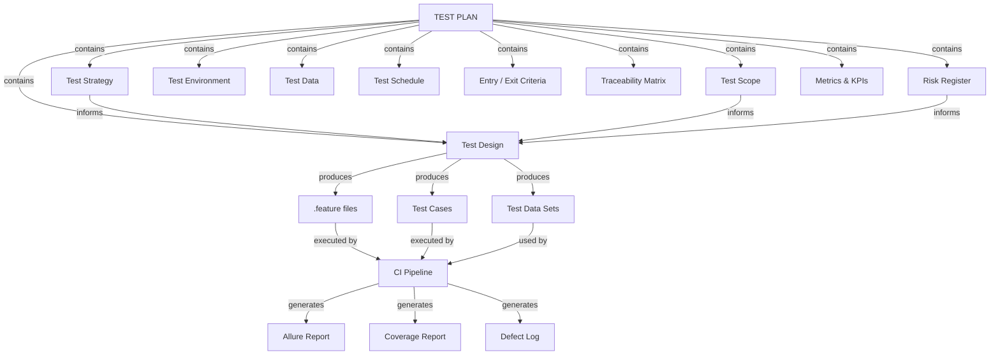

### 2.1 Artifact Map

| # | Artifact | Format | Location | Audience |
|---|---|---|---|---|
| 1 | Test Strategy | Markdown | `qa/strategy.md` | QA Lead, Dev Lead, Product |
| 2 | Test Scope | Markdown + Mermaid | `qa/scope.md` | All |
| 3 | Test Design (this doc) | Markdown + Mermaid + Schema | `qa-design-base.md` | QA Lead |
| 4 | Feature Files | Gherkin (`.feature`) | `features/` | QA, Dev |
| 5 | Test Cases (non-BDD) | YAML / JSON Schema | `qa/cases/` | QA |
| 6 | Test Data | YAML / JSON | `qa/data/` | QA, Dev |
| 7 | Environment Config | YAML | `qa/env/` | DevOps, QA |
| 8 | Schedule | Markdown table | `qa/schedule.md` | QA Lead, PM |
| 9 | Entry/Exit Criteria | Markdown | `qa/criteria.md` | QA Lead, Dev Lead |
| 10 | Traceability Matrix | CSV / Markdown table | `qa/traceability.csv` | QA Lead, Product |
| 11 | Risk Register | Markdown table | `qa/risk-register.md` | QA Lead, Dev Lead |
| 12 | Metrics Dashboard | Allure + Grafana | CI artifact | All |

---

## 3. Test Strategy (ISO 29119-2 §4.2)

The strategy is a **one-page decision document** that answers:

```
┌─────────────────────────────────────────────────────────────────────┐
│  STRATEGY DECISIONS                                                 │
├─────────────────────────────────────────────────────────────────────┤
│  1. What are we testing?        → Scope (capability list)           │
│  2. How much?                   → Risk-based allocation             │
│  3. At what level?              → Unit / Integration / E2E mix      │
│  4. With what tools?            → Playwright, Cucumber, Allure      │
│  5. How often?                  → PR / Nightly / Release            │
│  6. What is the exit gate?      → Entry/Exit criteria               │
│  7. What data?                  → Test data strategy                │
│  8. What environment?           → Env matrix                        │
│  9. Who owns what?              → RACI matrix                       │
│  10. How do we measure?         → KPIs and thresholds               │
└─────────────────────────────────────────────────────────────────────┘
```

### 3.1 Test Level Allocation

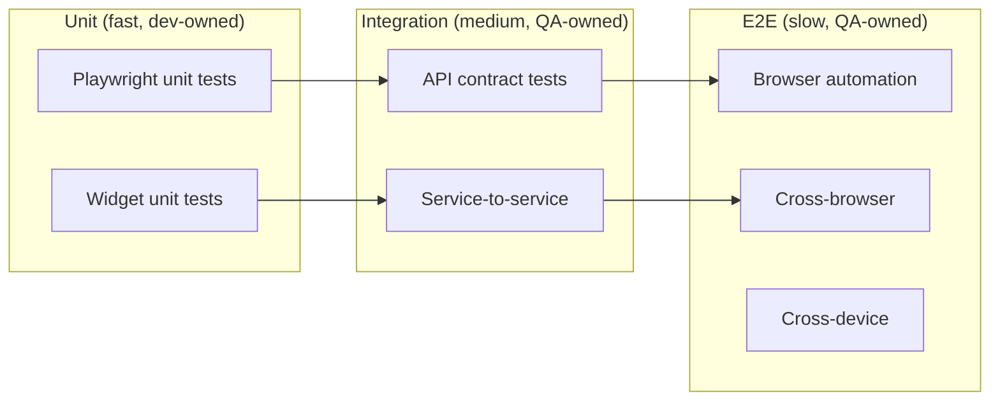

**Rule:** Every E2E scenario must have a corresponding integration or unit test that covers the same logic at a lower level. E2E is the *last* line of defense, not the *first*.

### 3.2 Risk-Based Allocation

```mermaid
quadrantChart
    title Risk vs. Effort
    x-axis Low Effort --> High Effort
    y-axis Low Risk --> High Risk
    quadrant-1 "Do First (High Risk, High Effort)"
    quadrant-2 "Delegate (High Risk, Low Effort)"
    quadrant-3 "Monitor (Low Risk, High Effort)"
    quadrant-4 "Skip / Automate (Low Risk, Low Effort)"

    "Browser Launch": 0.2, 0.8
    "Navigation": 0.3, 0.7
    "Screenshots": 0.1, 0.3
    "Dashboard Rendering": 0.4, 0.6
    "CLI Output Parsing": 0.2, 0.5
```

**Rule:** High-risk / high-effort items get manual test design + E2E automation. Low-risk / low-effort items get automated-only coverage.

---

## 4. Test Scope (ISO 29119-2 §4.3)

### 4.1 In-Scope / Out-of-Scope

```mermaid
flowchart LR
    subgraph "IN SCOPE"
        A[Browser Launch]
        B[Navigation]
        C[Screenshots]
        D[Dashboard Rendering]
        E[CLI Interface]
    end

    subgraph "OUT OF SCOPE"
        F[Third-party API reliability]
        G[Performance / Load]
        H[Security / Penetration]
        I[Accessibility (WCAG)]
    end
```

### 4.2 Capability Map

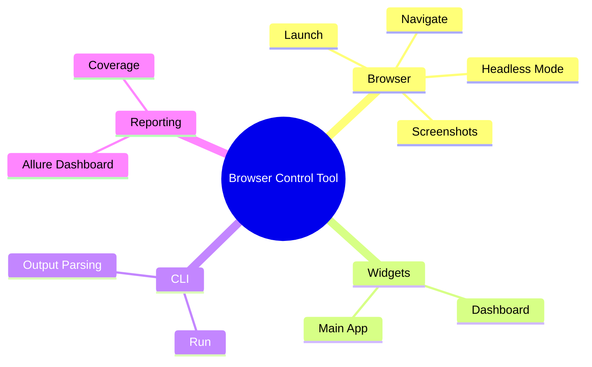

**Rule:** Each leaf node in the capability map = one `.feature` file. If a capability has no `.feature` file, it is a coverage gap.

---

## 5. Test Design (ISO 29119-2 §4.4)

This is the core section. It defines **how** test cases are derived from requirements.

### 5.1 Test Design Techniques

| Technique | When to Use | Example |
|---|---|---|
| **Equivalence Partitioning** | Input validation, parameter ranges | Viewport width: `320`, `768`, `1920` |
| **Boundary Value Analysis** | Numeric limits, thresholds | Launch time: `4.9s`, `5.0s`, `5.1s` |
| **Decision Table** | Multiple boolean conditions | Headless × User Agent × Viewport |
| **State Transition** | Multi-step flows | Browser: `closed → launching → ready → navigating → closed` |
| **Error Guessing** | Known bug patterns, edge cases | Empty URL, malformed viewport, timeout |
| **Pairwise / Combinatorial** | Many parameters, limited test budget | 5 params × 3 values = 15 combos, not 243 |

### 5.2 Decision Table Example

```
┌─────────────────────────────────────────────────────────────────────┐
│  Decision Table: Browser Launch                                     │
├──────────┬──────────┬──────────┬──────────┬─────────────────────────┤
│  Cond.   │  C1     │  C2     │  C3     │  Action / Expected       │
│  (Headless) (User Agent) (Viewport)  (Launch)                     │
├──────────┼──────────┼──────────┼──────────┼─────────────────────────┤
│  T1      │  Y      │  N      │  N      │  Launch default UA, 1920x1080 │
│  T2      │  Y      │  Y      │  N      │  Launch custom UA, 1920x1080 │
│  T3      │  Y      │  N      │  Y      │  Launch default UA, 375x667  │
│  T4      │  Y      │  Y      │  Y      │  Launch custom UA, 375x667   │
│  T5      │  N      │  N      │  N      │  Launch default UA, 1920x1080 (visible) │
└──────────┴──────────┴──────────┴──────────┴─────────────────────────┘
```

Each row = one `Scenario` or one `Scenario Outline` row.

### 5.3 State Transition Diagram

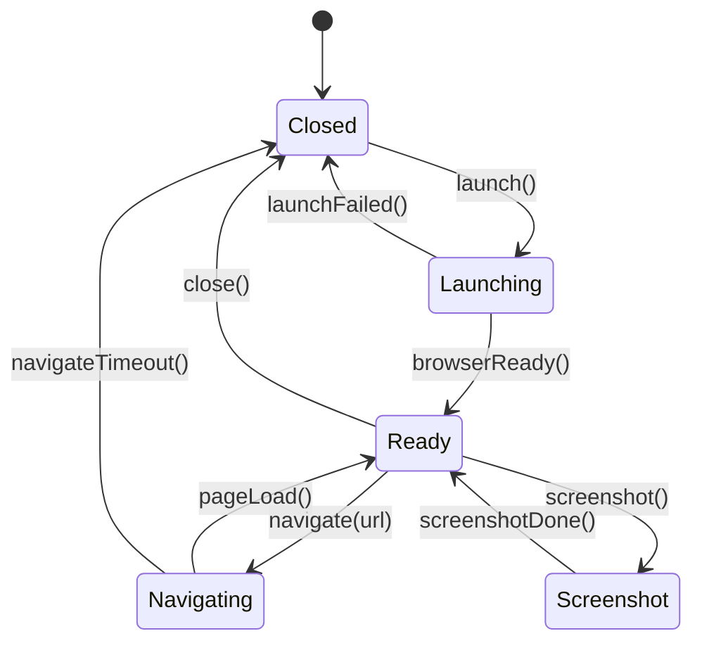

**Rule:** Every state transition that is a *user-visible behavior* must have a corresponding `Scenario`. Transitions that are internal implementation details do not need scenarios.

### 5.4 From Requirement to Test Case

```mermaid
flowchart LR
    R[Requirement / User Story] -->|derive| D[Test Design Technique]
    D -->|produce| TC[Test Case / Scenario]
    TC -->|map to| S[Step(s)]
    S -->|implement| SD[Step Definition]
    SD -->|execute| CI[CI Runner]
    CI -->|report| AL[Allure Report]
    AL -->|trace back to| R

    R -.->|@REQ-XXX| TC
    TC -.->|@REQ-XXX| S
    S -.->|@REQ-XXX| SD
```

**Rule:** Every test case must be traceable to at least one requirement (`@REQ-XXX`). Every requirement must have at least one test case. This is enforced in CI (see §9).

---

## 6. Feature File Specification (Gherkin)

### 6.1 File Schema

```
# features/<capability>/<name>.feature
#
# Capability: <name>
# Depends on: <shared/feature> (optional)
# Owner: <team/role>
# Risk: <low|medium|high>
#
@<run-set> @<priority> @<release>
Feature: <capability name>
  As a <role>
  I want <action>
  So that <benefit>

  Scenario: <what happens + expected outcome>
    Given <precondition>
    When <action>
    Then <expected result>
    And <additional expected result>
```

### 6.2 Tag Schema (YAML)

```yaml
# qa/tag-schema.yaml
tags:
  run_set:
    smoke:
      description: "Fast subset, runs on every PR"
      duration: "< 5 min"
      environment: "staging"
    regression:
      description: "Full suite, runs nightly"
      duration: "< 30 min"
      environment: "staging"
    e2e:
      description: "End-to-end browser tests"
      environment: "staging"
    api:
      description: "API-level tests, no browser"
      environment: "staging"
    integration:
      description: "Service-to-service, no UI"
      environment: "staging"

  priority:
    p0:
      description: "Must pass, blocks release"
      blocking: true
    p1:
      description: "Should pass, warn on failure"
      blocking: false
    p2:
      description: "Nice to have, skip if needed"
      blocking: false

  release:
    pattern: "@release-<major>.<minor>"
    description: "New scenarios for a specific release"

  state:
    wip:
      description: "Work in progress, exclude from runs"
      exclude: true
    flaky:
      description: "Known flaky, exclude + fix ticket"
      exclude: true
      requires_ticket: true
    known-bug:
      description: "Known bug, test expected to fail"
      exclude: false
      expected_failure: true

  traceability:
    req:
      pattern: "@REQ-<number>"
      description: "Linked to Jira/Linear ticket"
    ac:
      pattern: "@AC-<number>"
      description: "Linked to acceptance criteria"
```

### 6.3 Tag Placement Rules

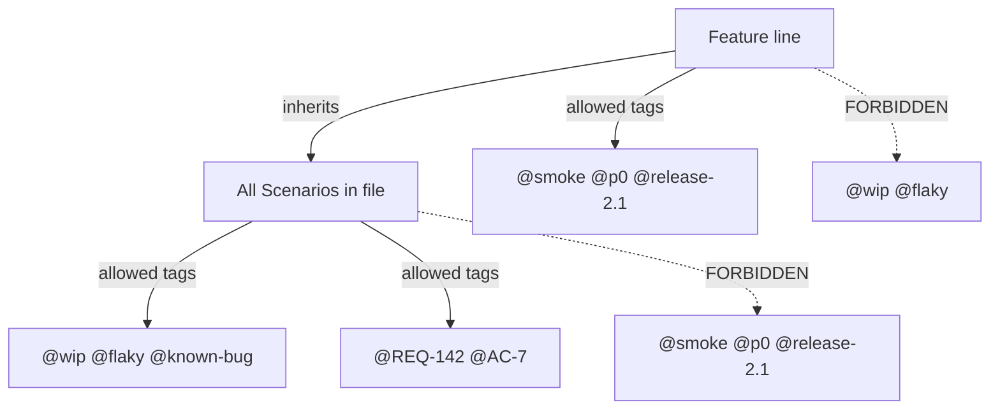

**Rule:** Run-set and priority tags go on `Feature` only. State and traceability tags go on `Scenario` only. Never duplicate.

### 6.4 Step Granularity Rules

```
┌─────────────────────────────────────────────────────────────────────┐
│  STEP GRANULARITY RULES                                             │
├─────────────────────────────────────────────────────────────────────┤
│  1. One step = one atomic action or assertion                       │
│  2. Max 5 steps per Given/When/Then block                           │
│  3. No compound assertions: "Then I see X and Y" → split           │
│  4. No hidden preconditions in When: "When I click the button"     │
│     (button must exist) → add Given                                 │
│  5. No implementation details in steps: "When I call launch()"     │
│     → "When I launch the browser"                                   │
│  6. Use Scenario Outline for data-driven variants                   │
│  7. Use Examples table for ≤ 10 rows; separate Scenarios for > 10  │
└─────────────────────────────────────────────────────────────────────┘
```

---

## 7. Test Case Schema (Non-BDD)

For tests that don't fit Gherkin (e.g., API tests, performance tests), use a **YAML schema**:

```yaml
# qa/cases/api-launch.yaml
schema: "qa-test-case/v1"
id: "API-LAUNCH-001"
title: "Launch API returns 200 with browser session"
requirement:
  - "@REQ-142"
tags:
  run_set: ["api", "smoke"]
  priority: "p0"
  release: "release-2.1"
  state: []
  traceability: ["@REQ-142"]

preconditions:
  - "API server is running on :3000"
  - "Test environment is healthy"

steps:
  - id: "S1"
    action: "POST /api/launch"
    payload:
      headless: true
      browser: "chromium"
      viewport: "1920x1080"
    expected:
      status: 200
      body.session_id: "string"
      body.browser: "chromium"

  - id: "S2"
    action: "GET /api/sessions/{session_id}"
    expected:
      status: 200
      body.state: "ready"

  - id: "S3"
    action: "DELETE /api/sessions/{session_id}"
    expected:
      status: 204

postconditions:
  - "Session is cleaned up"

data:
  - "qa/data/launch-default.yaml"

environment:
  - "staging"

owner: "qa-team"
risk: "high"
```

**Schema validation:** `qa/cases/*.yaml` must validate against `qa/schemas/test-case.schema.json` in CI.

### 7.1 JSON Schema for Test Cases

```json
{
  "$schema": "http://json-schema.org/draft-07/schema#",
  "title": "QA Test Case v1",
  "type": "object",
  "required": ["id", "title", "requirement", "tags", "steps"],
  "properties": {
    "id": {
      "type": "string",
      "pattern": "^[A-Z]+-[A-Z]+-[0-9]{3}$"
    },
    "title": {
      "type": "string",
      "minLength": 10,
      "maxLength": 120
    },
    "requirement": {
      "type": "array",
      "minItems": 1,
      "items": {
        "type": "string",
        "pattern": "^@REQ-[0-9]+$"
      }
    },
    "tags": {
      "type": "object",
      "required": ["run_set", "priority"],
      "properties": {
        "run_set": {
          "type": "array",
          "minItems": 1,
          "items": {
            "enum": ["smoke", "regression", "e2e", "api", "integration"]
          }
        },
        "priority": {
          "enum": ["p0", "p1", "p2"]
        },
        "release": {
          "type": "string",
          "pattern": "^release-[0-9]+\\.[0-9]+$"
        },
        "state": {
          "type": "array",
          "items": {
            "enum": ["wip", "flaky", "known-bug"]
          }
        },
        "traceability": {
          "type": "array",
          "items": {
            "pattern": "^@(REQ|AC)-[0-9]+$"
          }
        }
      }
    },
    "steps": {
      "type": "array",
      "minItems": 1,
      "maxItems": 20,
      "items": {
        "type": "object",
        "required": ["id", "action", "expected"],
        "properties": {
          "id": { "type": "string", "pattern": "^S[0-9]+$" },
          "action": { "type": "string" },
          "payload": { "type": "object" },
          "expected": { "type": "object" }
        }
      }
    },
    "preconditions": {
      "type": "array",
      "items": { "type": "string" }
    },
    "postconditions": {
      "type": "array",
      "items": { "type": "string" }
    },
    "data": {
      "type": "array",
      "items": {
        "type": "string",
        "pattern": "^qa/data/.*\\.yaml$"
      }
    },
    "environment": {
      "type": "array",
      "items": {
        "enum": ["dev", "staging", "prod"]
      }
    },
    "owner": {
      "type": "string"
    },
    "risk": {
      "enum": ["low", "medium", "high"]
    }
  }
}
```

---

## 8. Test Data Strategy

### 8.1 Data Classification

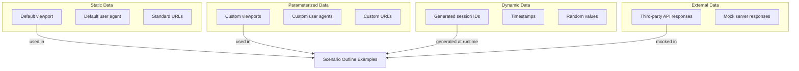

### 8.2 Data File Schema

```yaml
# qa/data/viewport-variants.yaml
schema: "qa-test-data/v1"
name: "viewport-variants"
description: "Viewport sizes for cross-device testing"
items:
  - id: "vp-mobile"
    width: 375
    height: 667
    label: "iPhone SE"
  - id: "vp-tablet"
    width: 768
    height: 1024
    label: "iPad"
  - id: "vp-desktop"
    width: 1920
    height: 1080
    label: "Desktop 1080p"
  - id: "vp-4k"
    width: 3840
    height: 2160
    label: "4K Monitor"
```

**Rule:** All test data must be in `qa/data/*.yaml`. No hardcoded values in `.feature` files or step definitions.

---

## 9. Traceability Matrix

### 9.1 Structure

```csv
# qa/traceability.csv
requirement_id,requirement_title,capability,feature_file,scenario_id,scenario_title,test_case_id,test_case_title,owner,risk,status
REQ-142,Browser launch,launch,features/browser/launch.feature,SC-LAUNCH-001,Launch headless Chromium,,API-LAUNCH-001,Launch API returns 200,qa-team,high,pass
REQ-142,Browser launch,launch,features/browser/launch.feature,SC-LAUNCH-002,Launch with custom user agent,,API-LAUNCH-002,Launch API with custom UA,qa-team,high,pass
REQ-143,Navigation,navigate,features/browser/navigate.feature,SC-NAV-001,Navigate to URL,,,,qa-team,medium,pending
```

### 9.2 Traceability Rules

```mermaid
flowchart LR
    R[Requirement] -->|1:N| F[Feature File]
    F -->|1:N| S[Scenario]
    S -->|1:N| TC[Test Case]
    TC -->|1:1| SD[Step Definition]
    TC -->|1:N| D[Test Data]

    R -.->|@REQ-XXX| F
    F -.->|@REQ-XXX| S
    S -.->|@REQ-XXX| TC
    TC -.->|@REQ-XXX| SD
```

**Rule:** The traceability matrix is **generated**, not hand-maintained. It is produced by a script from the `.feature` files and `qa/cases/*.yaml`:

```bash
# CI: generate traceability matrix
npx ts-node qa/scripts/generate-traceability.ts \
  --features "features/**/*.feature" \
  --cases "qa/cases/*.yaml" \
  --output "qa/traceability.csv"
```

### 9.3 Coverage Gaps

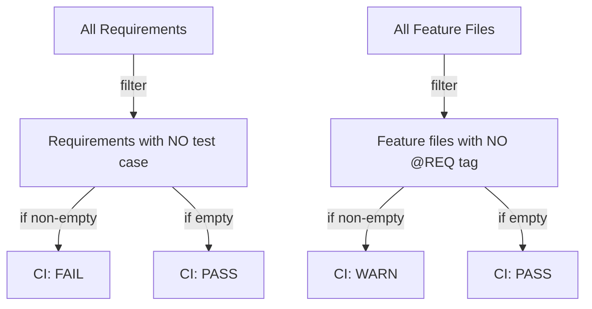

**Rule:** CI fails if any requirement has no test case. CI warns if any feature file has no requirement tag.

---

## 10. Risk Register

```markdown
# qa/risk-register.md

| ID   | Risk Description              | Likelihood (1-5) | Impact (1-5) | Score | Mitigation                          | Owner   | Status   |
|------|-------------------------------|------------------|--------------|-------|-------------------------------------|---------|----------|
| R-01 | Flaky browser launch          | 3                | 4            | 12    | @flaky tag + fix ticket             | qa-team | open     |
| R-02 | Timeout on slow CI runners    | 4                | 3            | 12    | Increase timeout to 30s             | dev     | open     |
| R-03 | Missing test data for new env | 2                | 5            | 10    | Add data file per env               | qa-team | open     |
| R-04 | Coverage gap in navigation    | 3                | 3            | 9     | Add scenarios for edge cases        | qa-team | open     |
```

**Scoring:** `Score = Likelihood × Impact`. Threshold: `Score ≥ 10` = high risk, requires mitigation before release.

---

## 11. Entry / Exit Criteria

### 11.1 Entry Criteria

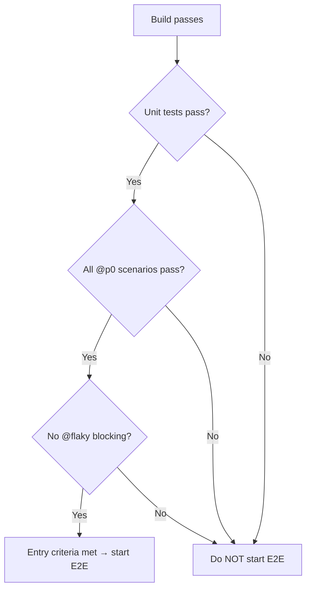

### 11.2 Exit Criteria

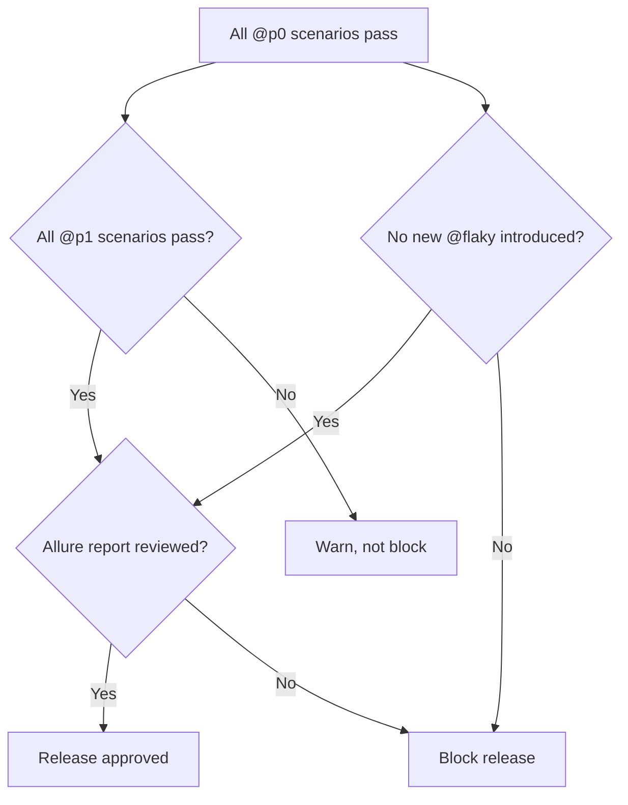

---

## 12. CI Pipeline (Execution)

```mermaid
flowchart TD
    subgraph "PR"
        A[PR opened] --> B[Gherkin Lint]
        B --> C{Lint pass?}
        C -->|No| FAIL[PR: FAIL]
        C -->|Yes| D[Unit Tests]
        D --> E{Unit pass?}
        E -->|No| FAIL
        E -->|Yes| F[Smoke E2E]
        F --> G{Smoke pass?}
        G -->|No| FAIL
        G -->|Yes| H[Tag Audit]
        H --> I{Tag audit pass?}
        I -->|No| WARN[PR: WARN]
        I -->|Yes| J[Allure Report]
        J --> K[PR: PASS]
    end

    subgraph "Merge to main"
        L[Merge] --> M[Full Regression]
        M --> N{Regression pass?}
        N -->|No| FAIL2[Block merge]
        N -->|Yes| O[Allure Report]
        O --> P[Release Candidate]
    end

    subgraph "Release"
        Q[Release X.Y] --> R[Release Plan]
        R --> S{All @release-X.Y pass?}
        S -->|No| FAIL3[Block release]
        S -->|Yes| T[Release Approved]
    end
```

### 12.1 CI Configuration

```yaml
# .github/workflows/test.yml
name: QA Pipeline

on:
  pull_request:
    branches: [main]
  push:
    branches: [main]

jobs:
  lint:
    runs-on: ubuntu-latest
    steps:
      - uses: actions/checkout@v4
      - run: npx gherkin-lint features/**/*.feature
      - run: npx ajv validate qa/schemas/test-case.schema.json qa/cases/*.yaml

  unit:
    runs-on: ubuntu-latest
    needs: lint
    steps:
      - uses: actions/checkout@v4
      - run: npm ci
      - run: npm test

  smoke:
    runs-on: ubuntu-latest
    needs: unit
    steps:
      - uses: actions/checkout@v4
      - run: npm ci
      - run: npx cucumber --tags "@smoke and not @wip" --format allure
      - uses: allure-io/allure-action@v2
        with:
          allure-report-path: allure-results/

  regression:
    if: github.ref == 'refs/heads/main'
    runs-on: ubuntu-latest
    needs: unit
    steps:
      - uses: actions/checkout@v4
      - run: npm ci
      - run: npx cucumber --tags "(@e2e and not @wip and not @flaky)" --format allure
      - uses: allure-io/allure-action@v2
        with:
          allure-report-path: allure-results/

  traceability:
    runs-on: ubuntu-latest
    needs: [lint, unit]
    steps:
      - uses: actions/checkout@v4
      - run: npm ci
      - run: npx ts-node qa/scripts/generate-traceability.ts
      - run: npx ts-node qa/scripts/check-coverage.ts
```

---

## 13. Metrics & KPIs

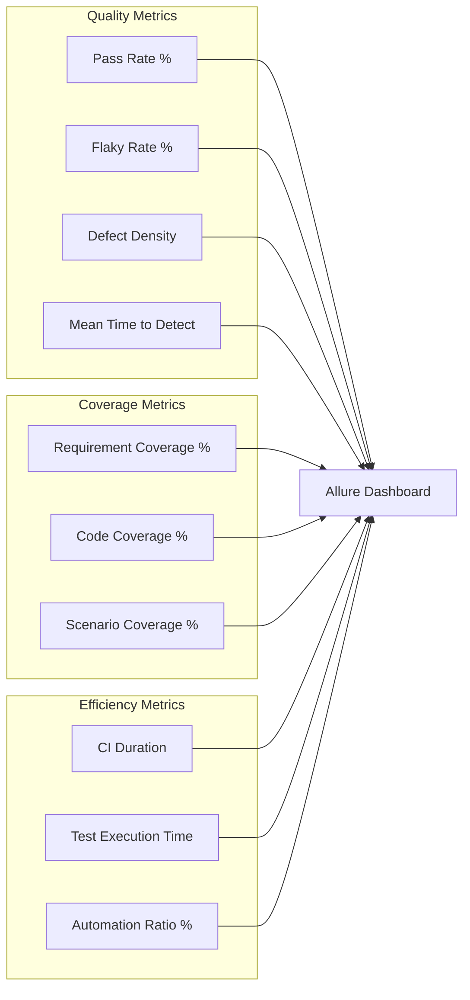

### 13.1 KPI Thresholds

| KPI | Target | Alert | Block |
|---|---|---|---|
| Pass Rate (smoke) | ≥ 95% | < 90% | < 80% |
| Flaky Rate | ≤ 2% | > 5% | > 10% |
| Requirement Coverage | 100% | — | < 95% |
| CI Duration (smoke) | ≤ 5 min | > 10 min | > 15 min |
| Automation Ratio | ≥ 80% | < 60% | < 40% |
| Mean Time to Detect | ≤ 4h | > 8h | > 24h |

---

## 14. RACI Matrix

| Activity | QA Lead | QA Engineer | Dev Lead | Dev | DevOps | Product |
|---|---|---|---|---|---|---|
| Test Strategy | **A** | C | C | I | I | C |
| Test Scope | **A** | R | C | I | I | C |
| Test Design | **A** | R | C | I | I | C |
| Feature Files | A | **R** | C | I | I | I |
| Step Definitions | I | C | **A** | R | I | I |
| CI Pipeline | C | I | C | I | **A** | I |
| Test Data | **A** | R | C | I | I | I |
| Release Gate | **A** | R | C | I | I | C |
| Defect Triage | **A** | R | C | R | I | I |

**R** = Responsible, **A** = Accountable, **C** = Consulted, **I** = Informed

---

## 15. Change Management

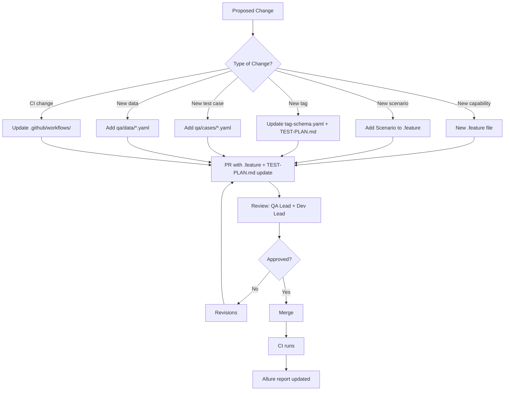

**Rule:** Any change to the test plan must be a PR. The PR must include:
1. The changed `.feature` / `.yaml` file
2. The updated `TEST-PLAN.md` (if tags or structure changed)
3. The updated `qa/traceability.csv` (auto-generated)
4. CI passing (lint + unit + smoke)

---

## 16. Hygiene Checklist (PR Review)

```markdown
- [ ] One file ≈ one capability (not one user story)
- [ ] ≤ 15 scenarios per file; more → split into sub-features
- [ ] ≤ 5 steps per Given/When/Then block
- [ ] One step = one atomic action
- [ ] No compound assertions in Then
- [ ] Scenario Outline used for data-driven variants
- [ ] Shared behavior in shared/ (not duplicated)
- [ ] Feature tags: run-set + priority + release (no state tags)
- [ ] Scenario tags: state + traceability (no run-set tags)
- [ ] All @REQ-XXX tags have matching tickets
- [ ] All tickets with tests have @REQ-XXX tags
- [ ] No hardcoded values in steps (use qa/data/*.yaml)
- [ ] Gherkin lint passes
- [ ] Test case YAML validates against schema
- [ ] Traceability matrix generated and up-to-date
- [ ] Risk register updated (if new risk identified)
- [ ] Entry/Exit criteria still met
```

---

## 17. Glossary

| Term | Definition |
|---|---|
| **Capability** | A business function or system behavior (e.g., "browser launch") |
| **Scenario** | A single test case in Gherkin |
| **Scenario Outline** | A parameterized scenario with an Examples table |
| **Run Set** | A named collection of tests to execute (smoke, regression) |
| **Tag Expression** | A boolean expression over tags (e.g., `@smoke and not @wip`) |
| **Traceability** | The link between requirements, tests, and defects |
| **Flaky** | A test that passes/fails non-deterministically |
| **WIP** | Work in progress — test not yet complete |
| **Entry Criteria** | Conditions that must be met before testing starts |
| **Exit Criteria** | Conditions that must be met before release |
| **Risk Score** | Likelihood × Impact (1-5 scale) |
| **KPI** | Key Performance Indicator for test quality |

---

## 18. Sources

- [ISO/IEC 29119-1:2013](https://www.iso.org/standard/63253.html) — Software engineering — Software testing — Part 1: Vocabulary and general terms
- [ISO/IEC 29119-2:2013](https://www.iso.org/standard/63254.html) — Software engineering — Software testing — Part 2: Test planning, test execution, test reporting
- [ISTQB Foundation Level Syllabus](https://www.istqb.org/education/istqb-foundation-level)
- [Cucumber Blog: "How to organise feature files?" (Seb Rose, 2021)](https://cucumber.io/blog/bdd/solving-how-to-organise-feature-files)
- [Gherkin Reference](https://github.com/cucumber/gherkin)
- [Allure Gherkin Integration](https://allurereport.org/docs/gherkin/)
- [Gherkin-lint](https://github.com/cucumber/gherkin-lint)
- [AJV JSON Schema Validator](https://ajv-validator.com/)
