# QA Design Base — Формализация Тест-Плана (RU)

> **Версия:** 1.0
> **Статус:** Живой документ — review в PR
> **Владелец:** QA Lead
> **Область:** Все тест-планы в этом репозитории

---

## 0. Назначение

Этот документ определяет **формальную методологию** создания, поддержки и выполнения тест-плана. Это *мета-спецификация*: каждый конкретный тест-план в этом репозитории должен соответствовать структурам, схемам и правилам, определённым здесь.

**Ключевой принцип:** Тест-план — это **версионированная, diff-ируемая, исполняемая спецификация** — не PDF, не Confluence, не экспорт TMS. Он живёт в Git, review-ится в PR и исполняется CI.

#details
### Почему тест-план — это код, а не документ?

Традиционный подход к тест-плану (Word, Confluence, PDF) имеет критические проблемы:

1. **Нет версионирования.** Тест-план в Confluence — это «снимок» на момент написания. Через две недели он устаревает, но никто не знает, какая версия актуальна. В Git каждая версия имеет hash, автора, дату и описание изменений.

2. **Нет diff.** Когда QA Lead меняет приоритет сценария с `@p0` на `@p1`, в Confluence это незаметно. В Git это однострочный diff:
   ```diff
   - @p0 @release-2.1
   + @p1 @release-2.1
   ```
   Это видно в PR, можно обсудить, можно откатить.

3. **Нет автоматической проверки.** В Confluence нельзя проверить, что все сценарии имеют `@REQ-XXX`. В CI можно:
   ```bash
   # Проверяем, что нет сценариев без traceability
   npx ts-node qa/scripts/check-traceability.ts
   ```

4. **Нет исполнения.** Тест-план в Confluence нельзя «запустить». `.feature` файлы исполняются Cucumber/Cypress/Playwright. Тест-план = код = исполняемый артефакт.

5. **Нет интеграции с CI/CD.** Тест-план в Confluence не знает, что PR открыт, что билд упал, что нужно запустить smoke. В Git + CI всё связано: PR → lint → unit → smoke → Allure → merge.

**Аналогия:** Тест-план в Git — это как `package.json` для зависимостей. Вы не храните список зависимостей в Word-документе. Вы храните его в `package.json`, и `npm install` знает, что делать.

**Почему именно Markdown + Gherkin + YAML?**
- **Markdown** — читаемый человеком, diff-ируемый, рендерится в GitHub/VS Code
- **Gherkin** — исполняемый формат спецификации (Cucumber, Behave, SpecFlow)
- **YAML** — структурированные данные (схемы, данные, конфигурация), валидируемые JSON Schema
- **Mermaid** — диаграммы прямо в Markdown, рендерятся в GitHub/VS Code без внешних инструментов

#details
### Почему не использовать TMS (Test Management System)?

TMS (TestRail, Zephyr, Xray, QTest) — это **инструмент для управления**, а не **формат спецификации**.

| Аспект | TMS | Git + Markdown + Gherkin |
|---|---|---|
| Хранение | В базе данных TMS | В Git (версионирование, diff, blame) |
| Доступ | Через веб-интерфейс TMS | Через Git (VS Code, GitHub, CLI) |
| Интеграция с CI | Через API TMS | Нatively (CI читает Git) |
| Diff | Нет (только история версий) | Да (git diff, blame, bisect) |
| Cost | Лицензия + хостинг | 0 (Git уже есть) |
| Portability | Привязан к TMS | Переносим (просто скопируйте репозиторий) |
| Code review | Нет | Да (PR review) |
| Automation | Через API | Нatively (CI) |

**Когда TMS всё-таки нужен:**
- Крупные команды (50+ QA) с разными ролями
- Необходимость сложного отчёта для руководства
- Интеграция с Jira/Linear на уровне TMS
- Необходимость управления тест-кейсами, которые не являются кодом

**Когда TMS не нужен (ваш случай):**
- Небольшая команда (1-5 QA)
- Все тесты — код (Playwright/Cucumber)
- CI уже настроен
- Нет необходимости в сложном отчёте для руководства

**Рекомендация:** Используйте Git + Markdown + Gherkin как **основу**. Если понадобится TMS — подключите его как **визуальный слой** (Allure → TMS), а не как **хранилище**.

---

## 1. Ссылочные стандарты

| Стандарт | Что он даёт |
|---|---|
| **ISO/IEC 29119-1** | Терминология, процессная модель, роли |
| **ISO/IEC 29119-2** | Планирование тестов, выполнение, отчётность |
| **ISTQB Foundation Level** | Техники проектирования тестов, уровни тестирования |
| **Cucumber / Gherkin** | Формат исполняемой спецификации |
| **Allure** | Отчётность и traceability |

Этот документ ссылается на соответствующие пункты стандартов там, где это уместно.

#details
### Зачем нужны стандарты, если мы пишем свой подход?

Вопрос логичный: «У нас свой проект, свои инструменты, зачем нам ISO?» Ответ: **стандарты — это не бюрократия, а общий язык**.

**1. Общий язык для команды.**
Когда вы говорите «тест-план», «тест-кейс», «сценарий», «критерий входа/выхода» — все понимают одно и то же. ISO 29119-1 определяет эти термины формально. Без этого в команде могут быть разные понимания:
- «Тест-кейс» для одного — это `.feature` файл, для другого — конкретный сценарий, для третьего — шаг в TMS.
- «Сценарий» для одного — это `Scenario` в Gherkin, для другого — это пользовательский сценарий (user story).

**2. Обоснование решений.**
Когда вы принимаете решение «мы не будем использовать TMS» или «мы будем использовать Gherkin вместо Jira test cases» — это не просто «мне нравится». Это обоснование:
- ISO 29119-2 §4.2 говорит, что тест-план должен включать scope, design, environment, schedule, criteria.
- Cucumber/Gherkin — это признанный формат исполняемой спецификации (BDD).
- Allure — это признанный инструмент отчётности.

**3. Переносимость.**
Если завтра вы смените команду, инструменты или проект — стандарты остаются. Новый разработчик, прочитав ISO 29119-2, поймёт структуру вашего тест-плана без объяснений.

**4. Аудит и сертификация.**
Если ваш продукт будет проходить аудит (ISO 27001, ISO 9001, CMMI) — наличие тест-плана по ISO 29119-2 будет обязательным. Без этого вы не сможете пройти аудит.

**5. Обучение.**
Новый QA в команде может пройти ISTQB Foundation Level (1-2 недели) и сразу понять, как устроены ваши тесты. Без стандартов — только «покажу, как мы делаем».

**Практическая рекомендация:** Не нужно читать все 500 страниц ISO. Достаточно:
- ISO 29119-1: терминология (глава 3)
- ISO 29119-2: тест-план (глава 4.2), тест-дизайн (глава 4.4)
- ISTQB: техники проектирования тестов (глава 5)

Остальное — по мере необходимости.

---

## 2. Иерархия артефактов тест-плана

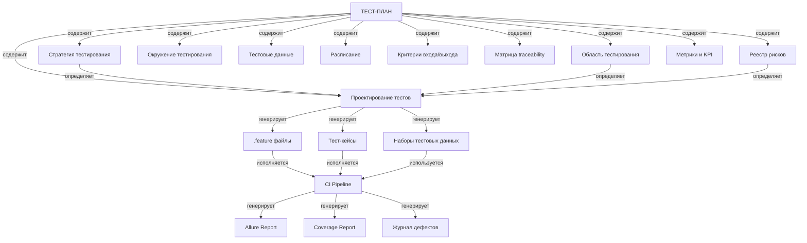

### 2.1 Карта артефактов

| # | Артефакт | Формат | Путь | Аудитория |
|---|---|---|---|---|
| 1 | Стратегия тестирования | Markdown | `qa/strategy.md` | QA Lead, Dev Lead, Product |
| 2 | Область тестирования | Markdown + Mermaid | `qa/scope.md` | Все |
| 3 | Проектирование тестов (этот документ) | Markdown + Mermaid + Schema | `qa-design-base.md` | QA Lead |
| 4 | Feature-файлы | Gherkin (`.feature`) | `features/` | QA, Dev |
| 5 | Тест-кейсы (non-BDD) | YAML / JSON Schema | `qa/cases/` | QA |
| 6 | Тестовые данные | YAML / JSON | `qa/data/` | QA, Dev |
| 7 | Конфигурация окружения | YAML | `qa/env/` | DevOps, QA |
| 8 | Расписание | Markdown table | `qa/schedule.md` | QA Lead, PM |
| 9 | Критерии входа/выхода | Markdown | `qa/criteria.md` | QA Lead, Dev Lead |
| 10 | Матрица traceability | CSV / Markdown table | `qa/traceability.csv` | QA Lead, Product |
| 11 | Реестр рисков | Markdown table | `qa/risk-register.md` | QA Lead, Dev Lead |
| 12 | Дашборд метрик | Allure + Grafana | CI artifact | Все |

#details
### Почему тест-план — это дерево артефактов, а не один документ?

Вопрос: «Почему не один большой файл `TEST-PLAN.md` на 500 строк?»

**Ответ: потому что у каждого артефакта разная аудитория, разная частота изменений и разная структура.**

**1. Разная аудитория.**
- Стратегия тестирования читает **Dev Lead** (ему важно, какие уровни тестирования мы используем).
- Feature-файлы читает **QA Engineer** (ему важно, какие сценарии нужно покрыть).
- Матрица traceability читает **Product** (ему важно, что каждое требование покрыто тестами).
- Реестр рисков читает **Dev Lead + QA Lead** (им важно, что может пойти не так).

Если всё в одном файле — каждый читает весь файл, но ему нужна только его часть. Это неэффективно.

**2. Разная частота изменений.**
- Стратегия меняется **раз в квартал** (когда меняется продукт или команда).
- Feature-файлы меняются **каждую неделю** (новые сценарии).
- Реестр рисков меняется **каждую неделю** (новые риски).
- Матрица traceability меняется **каждый раз, когда добавляется требование**.

Если всё в одном файле — каждый PR, который меняет feature-файл, тоже меняет весь тест-план. Diff становится огромным и нечитаемым.

**3. Разная структура.**
- Стратегия — это **текст + таблицы** (Markdown).
- Feature-файлы — это **исполняемый код** (Gherkin).
- Тест-кейсы — это **структурированные данные** (YAML + JSON Schema).
- Матрица traceability — это **таблица** (CSV).
- Реестр рисков — это **таблица** (Markdown).

Каждый формат имеет свои правила, свои валидаторы, свои инструменты. Разделение позволяет использовать разные инструменты для разных артефактов.

**4. Разная ответственность.**
- Стратегия — **QA Lead** (он принимает решения о стратегии).
- Feature-файлы — **QA Engineer** (он пишет сценарии).
- Тест-кейсы — **QA Engineer** (он пишет тест-кейсы).
- Матрица traceability — **генерируется автоматически** (скрипт).
- Реестр рисков — **QA Lead + Dev Lead** (они совместно определяют риски).

Разделение артефактов = разделение ответственности. Каждый артефакт имеет одного владельца.

**5. Разная автоматизация.**
- Feature-файлы — **исполняются** Cucumber.
- Тест-кейсы — **валидируются** JSON Schema.
- Матрица traceability — **генерируется** скриптом.
- Реестр рисков — **проверяется** на актуальность (скрипт).
- Стратегия — **review-ится** в PR (человек).

Каждый артефакт имеет свою автоматизацию. Разделение позволяет автоматизировать каждый артефакт отдельно.

**Аналогия:** Тест-план — это как проект в Git. У вас есть:
- `README.md` (стратегия)
- `src/` (feature-файлы)
- `tests/` (тест-кейсы)
- `data/` (тестовые данные)
- `docs/` (документация)
- `CI/` (автоматизация)

Вы не храните всё в одном файле. Вы разделяете по структуре. Тест-план — то же самое.

---

## 3. Стратегия тестирования (ISO 29119-2 §4.2)

Стратегия — это **одностраничный документ решений**, который отвечает на 10 вопросов:

```
┌─────────────────────────────────────────────────────────────────────┐
│  РЕШЕНИЯ СТРАТЕГИИ                                                  │
├─────────────────────────────────────────────────────────────────────┤
│  1. Что тестируем?          → Область (список capabilities)         │
│  2. Сколько?                → Риск-ориентированное распределение    │
│  3. На каком уровне?        → Unit / Integration / E2E микс         │
│  4. Чем?                    → Playwright, Cucumber, Allure          │
│  5. Как часто?              → PR / Nightly / Release                │
│  6. Что критерий выхода?    → Entry/Exit criteria                   │
│  7. Какие данные?           → Стратегия тестовых данных             │
│  8. Какое окружение?        → Матрица окружений                     │
│  9. Кто за что отвечает?    → RACI-матрица                          │
│  10. Как измеряем?          → KPI и пороги                          │
└─────────────────────────────────────────────────────────────────────┘
```

### 3.1 Распределение по уровням тестирования

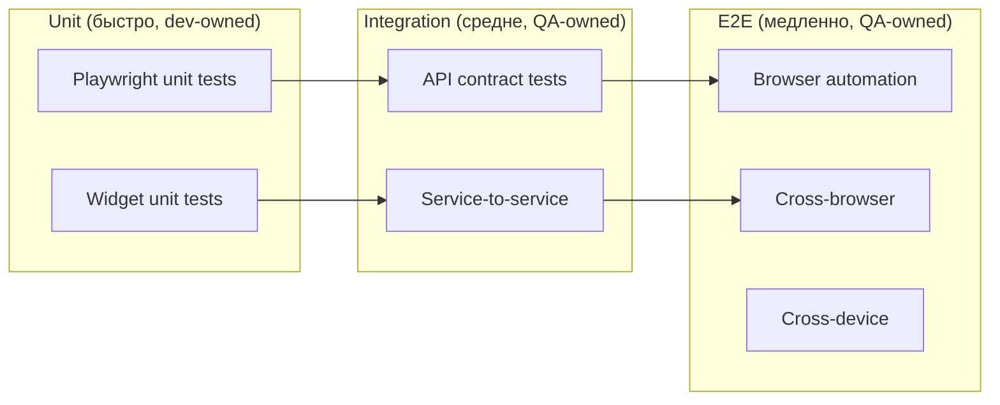

**Правило:** Каждый E2E-сценарий должен иметь соответствующий integration или unit-тест, который покрывает ту же логику на более низком уровне. E2E — это *последняя* линия обороны, а не *первая*.

### 3.2 Риск-ориентированное распределение

```mermaid
quadrantChart
    title Риск vs. Усилия
    x-axis Низкие усилия --> Высокие усилия
    y-axis Низкий риск --> Высокий риск
    quadrant-1 "Сначала (Высокий риск, Высокие усилия)"
    quadrant-2 "Делегировать (Высокий риск, Низкие усилия)"
    quadrant-3 "Мониторить (Низкий риск, Высокие усилия)"
    quadrant-4 "Пропустить / Автоматизировать (Низкий риск, Низкие усилия)"

    "Запуск браузера": 0.2, 0.8
    "Навигация": 0.3, 0.7
    "Скриншоты": 0.1, 0.3
    "Рендеринг дашборда": 0.4, 0.6
    "Парсинг CLI вывода": 0.2, 0.5
```

**Правило:** Высокий риск / высокие усилия → ручной дизайн тестов + E2E-автоматизация. Низкий риск / низкие усилия → только автоматизированное покрытие.

#details
### Что такое стратегия тестирования и зачем она нужна?

**Стратегия тестирования** — это документ, который отвечает на вопрос: **«Как мы будем тестировать этот продукт?»** Это не список тестов. Это набор решений, которые принимаются **один раз** (или раз в квартал) и определяют **направление** всей тестовой деятельности.

**Аналогия:** Стратегия тестирования — это как **архитектурный документ** для разработки. Вы не пишете каждый модуль в архитектурном документе. Вы описываете:
- Какие уровни абстракции используем
- Какие паттерны применяем
- Какие ограничения есть
- Как модули взаимодействуют

Стратегия тестирования делает то же самое для тестов:
- Какие уровни тестирования используем (unit / integration / E2E)
- Какие инструменты применяем (Playwright, Cucumber, Allure)
- Как часто запускаем тесты (PR / nightly / release)
- Какие критерии выхода есть (entry/exit criteria)

**Почему стратегия — это одностраничный документ?**

Потому что стратегия — это **решения**, а не **детали**. Детали — в feature-файлах и тест-кейсах. Стратегия должна быть:
- **Короткой** (1 страница) — чтобы её можно было прочитать за 5 минут
- **Ясной** — чтобы каждый в команде понимал, как мы тестируем
- **Обновляемой** — когда меняется продукт или команда

**Что входит в стратегию (10 вопросов):**

1. **Что тестируем?** — Список capabilities (browser launch, navigation, screenshots, etc.). Это не список сценариев, а список **бизнес-функций**.

2. **Сколько?** — Риск-ориентированное распределение. Не все функции тестируем одинаково. Высокий риск → больше тестов. Низкий риск → меньше тестов.

3. **На каком уровне?** — Unit / Integration / E2E микс. Например: 70% unit, 20% integration, 10% E2E. Это не жёсткое правило, а ориентир.

4. **Чем?** — Инструменты. Playwright для E2E, Cucumber для BDD, Allure для отчётности. Это не «мы используем Playwright», а «мы используем Playwright для E2E, Cucumber для BDD, Allure для отчётности».

5. **Как часто?** — Частота запуска. PR → smoke (5 мин), nightly → regression (30 мин), release → full (60 мин). Это не «мы запускаем тесты каждый день», а «мы запускаем smoke на каждый PR, regression каждую ночь, full на каждый релиз».

6. **Что критерий выхода?** — Entry/Exit criteria. Entry: build passes, unit tests pass, all @p0 scenarios pass. Exit: all @p0 pass, no @flaky blocking, Allure report reviewed.

7. **Какие данные?** — Стратегия тестовых данных. Статические данные в `qa/data/*.yaml`, параметризированные данные в `Scenario Outline`, динамические данные генерируются в рантайме.

8. **Какое окружение?** — Матрица окружений. Dev (локально), staging (CI), prod (релиз). Каждое окружение имеет свои данные, свои ограничения, свои правила.

9. **Кто за что отвечает?** — RACI-матрица. Кто принимает решения (A), кто выполняет (R), кого консультируют (C), кого информируют (I).

10. **Как измеряем?** — KPI и пороги. Pass rate ≥ 95%, flaky rate ≤ 2%, requirement coverage 100%, CI duration ≤ 5 мин.

**Почему стратегия — это не тест-план?**

Стратегия — это **направление**. Тест-план — это **детали**. Стратегия говорит «мы тестируем на 3 уровнях, используем Playwright, запускаем smoke на каждый PR». Тест-план говорит «вот конкретные сценарии, вот конкретные данные, вот конкретное расписание».

**Аналогия:** Стратегия — это **карта**. Тест-план — это **маршрут**. Карта говорит «идите на север, через лес, к реке». Маршрут говорит «шаг 1: налево, шаг 2: прямо 100 м, шаг 3: через мост».

**Когда обновлять стратегию?**
- Меняется продукт (новая фича, новый пользователь)
- Меняется команда (новый QA Lead, новый Dev Lead)
- Меняются инструменты (Playwright → Cypress, Cucumber → Jest)
- Меняется CI (GitHub Actions → GitLab CI)
- Раз в квартал (плановое обновление)

**Когда НЕ обновлять стратегию?**
- Добавляется новый сценарий (это тест-план, не стратегия)
- Меняется приоритет сценария (это тест-план, не стратегия)
- Добавляется новый тег (это тест-план, не стратегия)
- Меняется окружение (это тест-план, не стратегия)

**Практический пример:**

Стратегия (не меняется каждую неделю):
```
Мы тестируем browser-control-tool на 3 уровнях:
- Unit: Playwright unit tests (70%)
- Integration: API contract tests (20%)
- E2E: Browser automation (10%)

Инструменты: Playwright, Cucumber, Allure
Частота: PR → smoke (5 мин), nightly → regression (30 мин), release → full (60 мин)
Критерии: Entry: build+unit+@p0 pass. Exit: @p0 pass, no @flaky, Allure reviewed.
```

Тест-план (меняется каждую неделю):
```
В features/browser/launch.feature добавлен сценарий:
- Launch headless Chromium (@smoke @p0 @release-2.1)
- Launch with custom user agent (@regression @p1 @release-2.1)
- Launch with viewport 375x667 (@regression @p1 @release-2.1)
```

Стратегия не меняется. Тест-план меняется. Это нормально.

---

## 4. Область тестирования (ISO 29119-2 §4.3)

### 4.1 В scope / Out of scope

```mermaid
flowchart LR
    subgraph "В SCOPE"
        A[Запуск браузера]
        B[Навигация]
        C[Скриншоты]
        D[Рендеринг дашборда]
        E[CLI интерфейс]
    end

    subgraph "ВНЕ SCOPE"
        F[Надёжность сторонних API]
        G[Производительность / Load]
        H[Безопасность / Penetration]
        I[Доступность (WCAG)]
    end
```

### 4.2 Карта capabilities

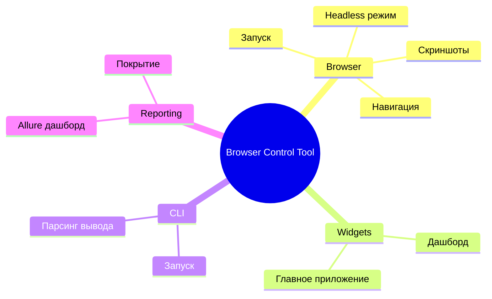

**Правило:** Каждый листовой узел в карте capabilities = один `.feature` файл. Если capability нет `.feature` файла — это gap в покрытии.

#details
### Что такое область тестирования и почему она важна?

**Область тестирования (Test Scope)** — это ответ на вопрос: **«Что мы тестируем, а что — нет?»** Это не список сценариев. Это **граница** между тем, что входит в тестирование, и тем, что не входит.

**Почему область — это отдельный артефакт, а не часть стратегии?**

Потому что область меняется **чаще, чем стратегия**, но **реже, чем feature-файлы**. Стратегия меняется раз в квартал. Область меняется раз в спринт (когда добавляется новая фича). Feature-файлы меняются каждую неделю.

**Что входит в область?**

1. **In-Scope** — то, что мы тестируем. Это список capabilities:
   - Browser Launch (запуск браузера)
   - Navigation (навигация)
   - Screenshots (скриншоты)
   - Dashboard Rendering (рендеринг дашборда)
   - CLI Interface (CLI интерфейс)

2. **Out-of-Scope** — то, что мы НЕ тестируем. Это важно, потому что:
   - Без out-of-scope каждый хочет тестировать всё
   - Out-of-scope — это **явное решение**, а не «мы просто не дошли»
   - Out-of-scope можно пересматривать (если риск изменился)

**Почему out-of-scope — это важно?**

**Пример:** Вы не тестируете «надёжность сторонних API». Это не значит, что вы не тестируете интеграцию с API. Это значит, что вы **не тестируете, что API будет работать**. Вы тестируете, что **ваш код правильно обрабатывает ответ API** (mocked response).

**Аналогия:** Вы не тестируете, что интернет работает. Вы тестируете, что ваш сайт работает, если интернет работает.

**Как определить in-scope / out-of-scope?**

**Критерии in-scope:**
- Это часть продукта, который мы поставляем
- Это влияет на пользовательский опыт
- Это может сломаться из-за изменений в нашем коде
- Это связано с бизнес-требованием

**Критерии out-of-scope:**
- Это сторонний сервис (мы не контролируем его)
- Это инфраструктура (мы не контролируем её)
- Это не связано с бизнес-требованием
- Это требует отдельного проекта (performance, security, accessibility)

**Практический пример:**

In-Scope:
```
- Browser Launch: запуск браузера, headless, viewport
- Navigation: переход по URL, ожидание загрузки
- Screenshots: сохранение скриншота, проверка размера
- Dashboard Rendering: рендеринг дашборда, проверка элементов
- CLI Interface: запуск CLI, парсинг вывода
```

Out-of-Scope:
```
- Third-party API reliability: мы не тестируем, что API будет работать
- Performance / Load: мы не тестируем, что сайт выдержит 1000 пользователей
- Security / Penetration: мы не тестируем, что сайт не будет взломан
- Accessibility (WCAG): мы не тестируем, что сайт будет доступен для слепых
```

**Почему out-of-scope — это не «мы не будем тестировать»?

Потому что out-of-scope — это **явное решение**, которое:
- Обосновано (почему мы не тестируем)
- Пересматривается (если риск изменился)
- Документировано (в `qa/scope.md`)
- Review-ится (в PR)

**Аналогия:** Out-of-scope — это как **исключения в коде**. Вы не пишете `if (x == 1) { ... }` для каждого значения x. Вы пишете `if (x != 1) { ... }` и говорите: «Для x == 1 мы не делаем ничего». Out-of-scope — это то же самое для тестов.

**Когда пересматривать область?**
- Добавляется новая фича (входит в scope)
- Убирается фича (выходит из scope)
- Меняется риск (out-of-scope может стать in-scope)
- Раз в спринт (плановое обновление)

**Практический пример:**

Спринт 1:
```
In-Scope: Browser Launch, Navigation
Out-of-Scope: Screenshots, Dashboard, CLI
```

Спринт 2:
```
In-Scope: Browser Launch, Navigation, Screenshots
Out-of-Scope: Dashboard, CLI
```

Спринт 3:
```
In-Scope: Browser Launch, Navigation, Screenshots, Dashboard
Out-of-Scope: CLI
```

Область меняется. Стратегия не меняется. Feature-файлы меняются. Это нормально.

---

## 5. Проектирование тестов (ISO 29119-2 §4.4)

Это **ключевой раздел**. Он определяет **как** тест-кейсы выводятся из требований.

### 5.1 Техники проектирования тестов

| Техника | Когда использовать | Пример |
|---|---|---|
| **Разбиение на эквивалентные классы** | Валидация ввода, диапазоны параметров | Ширина viewport: `320`, `768`, `1920` |
| **Анализ граничных значений** | Числовые лимиты, пороги | Время запуска: `4.9с`, `5.0с`, `5.1с` |
| **Таблица решений** | Несколько булевых условий | Headless × User Agent × Viewport |
| **Переходы состояний** | Многошаговые потоки | Браузер: `закрыт → запускается → готов → навигирует → закрыт` |
| **Оценка ошибок** | Известные паттерны багов, edge cases | Пустой URL, некорректный viewport, таймаут |
| **Парные / комбинаторные** | Много параметров, ограниченный бюджет тестов | 5 парам × 3 значения = 15 комбинаций, а не 243 |

### 5.2 Пример таблицы решений

```
┌─────────────────────────────────────────────────────────────────────┐
│  Таблица решений: Запуск браузера                                  │
├──────────┬──────────┬──────────┬──────────┬─────────────────────────┤
│  Условие │  C1     │  C2     │  C3     │  Действие / Ожидание     │
│  (Headless) (User Agent) (Viewport)  (Запуск)                     │
├──────────┼──────────┼──────────┼──────────┼─────────────────────────┤
│  T1      │  ДА     │  НЕТ    │  НЕТ    │  Запуск дефолтный UA, 1920x1080 │
│  T2      │  ДА     │  ДА     │  НЕТ    │  Запуск кастомный UA, 1920x1080 │
│  T3      │  ДА     │  НЕТ    │  ДА     │  Запуск дефолтный UA, 375x667  │
│  T4      │  ДА     │  ДА     │  ДА     │  Запуск кастомный UA, 375x667   │
│  T5      │  НЕТ    │  НЕТ    │  НЕТ    │  Запуск дефолтный UA, 1920x1080 (видимый) │
└──────────┴──────────┴──────────┴──────────┴─────────────────────────┘
```

Каждая строка = один `Scenario` или одна строка `Scenario Outline`.

### 5.3 Диаграмма переходов состояний

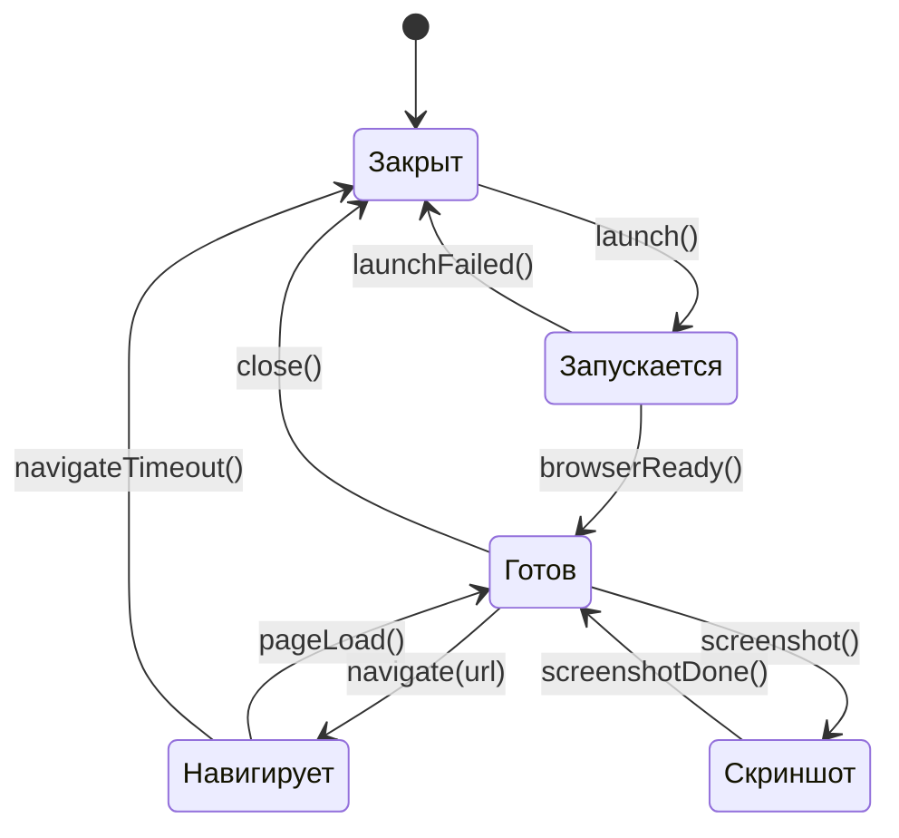

**Правило:** Каждый переход состояния, который является *поведением, видимым пользователю*, должен иметь соответствующий `Scenario`. Переходы, которые являются внутренними деталями реализации, не требуют сценариев.

### 5.4 От требования к тест-кейсу

```mermaid
flowchart LR
    R[Требование / User Story] -->|вывести| D[Техника проектирования]
    D -->|создать| TC[Тест-кейс / Сценарий]
    TC -->|соотнести| S[Шаг(и)]
    S -->|реализовать| SD[Step Definition]
    SD -->|исполнить| CI[CI Runner]
    CI -->|отчёт| AL[Allure Report]
    AL -->|отследить обратно| R

    R -.->|@REQ-XXX| TC
    TC -.->|@REQ-XXX| S
    S -.->|@REQ-XXX| SD
```

**Правило:** Каждый тест-кейс должен быть прослеживаемым до хотя бы одного требования (`@REQ-XXX`). Каждое требование должно иметь хотя бы один тест-кейс. Это контролируется в CI (см. §9).

#details
### Что такое проектирование тестов и почему это ключевой раздел?

**Проектирование тестов (Test Design)** — это ответ на вопрос: **«Как мы получаем тест-кейсы из требований?»** Это не «написать тесты». Это **систематический процесс** вывода тест-кейсов из требований с гарантией, что покрытие полное и нет дублирования.

**Почему проектирование — это ключевой раздел?**

Потому что **качество тестов определяется не на этапе написания, а на этапе проектирования**. Если вы неправильно спроектировали тесты — вы напишете много тестов, но они будут:
- Дублировать друг друга
- Не покрывать важные сценарии
- Не покрывать edge cases
- Быть слишком детальными (тестировать реализацию, а не поведение)

**Аналогия:** Проектирование тестов — это как **архитектура** в разработке. Вы не пишете код, вы проектируете. Если архитектура плохая — код будет плохим, сколько бы вы его ни писали. Если архитектура хорошая — код будет хорошим.

**6 техник проектирования — это не «выберите одну», а «используйте все там, где уместно»:**

1. **Разбиение на эквивалентные классы** — когда есть **диапазон** значений.
   - Пример: viewport width. Диапазон: 320–3840. Эквивалентные классы: mobile (320–768), tablet (768–1280), desktop (1280–1920), 4K (1920–3840).
   - Тестируем по одному представителю из каждого класса: 375, 768, 1920, 3840.
   - Не тестируем 320, 321, 322, ..., 3840. Это бессмысленно.

2. **Анализ граничных значений** — когда есть **лимит** (число, порог).
   - Пример: время запуска < 5 секунд. Граничные значения: 4.9с (проходит), 5.0с (граница), 5.1с (не проходит).
   - Тестируем только граничные значения, а не все значения от 0 до 100.

3. **Таблица решений** — когда есть **несколько булевых условий**.
   - Пример: Headless (да/нет) × User Agent (да/нет) × Viewport (да/нет) = 8 комбинаций.
   - Но не все комбинации равны по важности. Таблица решений помогает выбрать, какие комбинации тестировать.
   - Каждая строка таблицы = один сценарий.

4. **Переходы состояний** — когда есть **многошаговый поток**.
   - Пример: браузер: закрыт → запускается → готов → навигирует → закрыт.
   - Каждый переход = потенциальный сценарий.
   - Но только те переходы, которые видны пользователю.

5. **Оценка ошибок** — когда есть **известные паттерны багов**.
   - Пример: пустой URL, некорректный viewport, таймаут.
   - Это не систематическая техника, а **опыт**. Но она важна.

6. **Парные / комбинаторные** — когда есть **много параметров**, но **ограниченный бюджет**.
   - Пример: 5 параметров × 3 значения = 243 комбинации.
   - Но мы не можем протестировать 243 комбинации.
   - Парный анализ: 5 параметров × 2 значения = 15 комбинаций.
   - Это покрывает все пары значений, но не все комбинации.

**Как выбрать технику?**

```
Есть диапазон значений? → Разбиение на эквивалентные классы
Есть лимит/порог? → Анализ граничных значений
Есть несколько булевых условий? → Таблица решений
Есть многошаговый поток? → Переходы состояний
Есть известные паттерны багов? → Оценка ошибок
Много параметров, мало бюджета? → Парный анализ
```

**Практический пример: проектирование сценариев для «Запуск браузера»**

Требование: «Пользователь может запустить браузер в headless режиме с кастомным user agent и viewport».

**Шаг 1: Определить параметры.**
- Headless: да/нет
- User Agent: да/нет
- Viewport: да/нет

**Шаг 2: Выбрать технику.**
- Несколько булевых условий → Таблица решений.

**Шаг 3: Составить таблицу решений.**
```
T1: Headless=да, UA=нет, Viewport=нет → Запуск дефолтный UA, 1920x1080
T2: Headless=да, UA=да, Viewport=нет → Запуск кастомный UA, 1920x1080
T3: Headless=да, UA=нет, Viewport=да → Запуск дефолтный UA, 375x667
T4: Headless=да, UA=да, Viewport=да → Запуск кастомный UA, 375x667
T5: Headless=нет, UA=нет, Viewport=нет → Запуск дефолтный UA, 1920x1080 (видимый)
```

**Шаг 4: Преобразовать в сценарии.**
```gherkin
Feature: Запуск браузера
  @smoke @p0 @release-2.1

  Scenario: Запуск headless Chromium
    Given чистое окружение
    When я запускаю Chromium в headless режиме
    Then браузер должен быть готов к навигации
    And время запуска должно быть меньше "5" секунд

  Scenario: Запуск с кастомным user agent
    Given чистое окружение
    When я запускаю Chromium с user agent "Mozilla/5.0"
    Then браузер должен сообщить кастомный user agent

  Scenario Outline: Запуск с viewport
    Given чистое окружение
    When я запускаю Chromium с viewport "<width>x<height>"
    Then браузер должен сообщить viewport "<width>x<height>"

    Examples:
      | width | height |
      | 375   | 667    |
      | 768   | 1024   |
      | 1920  | 1080   |
```

**Шаг 5: Проверить покрытие.**
- T1 → Scenario 1
- T2 → Scenario 2
- T3, T4 → Scenario Outline (Examples)
- T5 → (не покрыт, добавить сценарий)

**Шаг 6: Добавить traceability.**
- Все сценарии → @REQ-142

**Результат:** 3 сценария покрывают 5 комбинаций. Нет дублирования. Нет gap.

**Почему это важно?**

Потому что без проектирования вы бы:
- Написали 5 отдельных сценариев (дублирование)
- Или написали 1 сценарий (непокрытие)
- Или написали 243 сценария (переполнение)

С проектированием вы пишете **минимум** сценариев, которые покрывают **максимум** поведения.

**Аналогия:** Проектирование тестов — это как **оптимизация запроса в SQL**. Вы не пишете `SELECT * FROM table WHERE x = 1 OR x = 2 OR x = 3 OR ...`. Вы пишете `SELECT * FROM table WHERE x IN (1, 2, 3)`. То же самое для тестов: не 243 сценария, а 3 сценария с Examples.

**Когда пересматривать проектирование?**
- Меняется требование (новые параметры, новые лимиты)
- Меняется продукт (новая фича)
- Раз в спринт (плановое обновление)

**Практический пример:**

Спринт 1:
```
Требование: Запуск браузера в headless режиме.
Параметры: Headless (да/нет).
Техника: Разбиение на эквивалентные классы.
Сценарии: 2 (headless, visible).
```

Спринт 2:
```
Требование: Запуск браузера с кастомным user agent.
Параметры: Headless (да/нет), UA (да/нет).
Техника: Таблица решений.
Сценарии: 4 (комбинации).
```

Спринт 3:
```
Требование: Запуск браузера с viewport.
Параметры: Headless (да/нет), UA (да/нет), Viewport (да/нет).
Техника: Таблица решений + Парный анализ.
Сценарии: 3 (сценарии + Scenario Outline).
```

Проектирование меняется. Стратегия не меняется. Область меняется. Feature-файлы меняются. Это нормально.

---

## 6. Спецификация Feature-файла (Gherkin)

> **Цель раздела:** Описать формальный шаблон .feature файлов — «каркас», на который опираются все BDD-тесты в проекте. Этот раздел отвечает на вопрос: «Как должен выглядеть каждый .feature файл, чтобы он был исполняемым, diff-ируемым и понятным любому члену команды?»

### 6.1 Схема файла

Каждый .feature файл — это **исполняемая спецификация** в формате Gherkin. Ниже приведён обязательный шаблон, который должен соблюдать каждый файл в каталоге features/.

```
# features/<capability>/<name>.feature
#
# Capability: <name>
# Depends on: <shared/feature> (optional)
# Owner: <team/role>
# Risk: <low|medium|high>
#
@<run-set> @<priority> @<release>
Feature: <capability name>
  As a <role>
  I want <action>
  So that <benefit>

  Scenario: <what happens + expected outcome>
    Given <precondition>
    When <action>
    Then <expected result>
    And <additional expected result>
```

**Разбор каждого элемента:**

| Элемент | Обязательность | Описание |
|---|---|---|
| features/<capability>/<name>.feature | Да | Путь к файлу. <capability> —业务能力 (например, browser, navigation). <name> — имя сценария в snake_case. |
| Capability: | Да | Указывает, к какой业务能力 относится файл. Используется для группировки в отчётах и traceability. |
| Depends on: | Нет | Указывает на другие feature-файлы, от которых зависит текущий. Полезно для понимания порядка выполнения. |
| Owner: | Да | Команда или роль, ответственная за поддержку этого файла. При сбое теста — сразу понятно, кто чинит. |
| Risk: | Да | Уровень риска: low / medium / high. Определяет, насколько критичен сбой этого файла для релиза. |
| @<run-set> @<priority> @<release> | Да | Теги на уровне Feature. См. 6.2 и 6.3. |
| Feature: | Да | Заголовок业务能力. Описывает **что** тестируется, а не **как**. |
| As a <role> | Да | Роль пользователя (например, «пользователь», «администратор»). Привязывает тест к бизнес-ценности. |
| I want <action> | Да | Действие, которое хочет выполнить пользователь. |
| So that <benefit> | Да | Бизнес-польза. Ответ на вопрос «зачем это нужно?». |
| Scenario: | Да | Конкретный сценарий поведения. Один сценарий = один путь через систему. |
| Given <precondition> | Да | Предусловие: состояние системы до начала сценария. |
| When <action> | Да | Действие: то, что делает пользователь/система. |
| Then <expected result> | Да | Ожидаемый результат: что должно быть после действия. |
| And <additional expected result> | Нет | Дополнительные проверки в том же Then-блоке. |

**Почему именно такая структура?**

1. **Комментарии в начале файла** (#) — это метаданные, которые читаются скриптами генерации traceability. Они не влияют на исполнение Gherkin, но дают контекст для людей и CI.

2. **As a / I want / So that** — это не формальность. Это **привязка к бизнес-ценности**. Если вы не можете сформулировать «So that», значит, тест не связан с реальным бизнес-требованием и, возможно, не нужен.

3. **Scenario** — это **минимальная единица поведения**. Один сценарий проверяет один путь. Если у вас 5 разных путей — это 5 сценариев, а не один сценарий с 5 When-блоками.

4. **Given** — это **состояние**, а не действие. Не «Given я нажимаю кнопку», а «Given кнопка «Отправить» видна на странице». Это предотвращает смешение предположений с действиями.

5. **When** — это **одно действие**. Не «When я нажимаю кнопку и заполняю форму», а два отдельных When-блока (или два сценария).

6. **Then** — это **проверка результата**. Не «Then всё работает», а «Then страница показывает сообщение «Успех»». Конкретика — это то, что делает тест исполняемым.

**Пример правильного файла:**

```gherkin
# features/browser/launch.feature
#
# Capability: browser
# Depends on: (none)
# Owner: qa-team
# Risk: high
#
@smoke @p0 @release-2.1
Feature: Запуск браузера
  As a пользователь
  I want запустить браузер в headless режиме
  So that я могу выполнять автоматизированные тесты без визуального окна

  Scenario: Запуск headless Chromium
    Given чистое окружение
    When я запускаю Chromium в headless режиме
    Then браузер должен быть готов к навигации
    And время запуска должно быть меньше "5" секунд
```

**Пример неправильного файла (и почему):**

```gherkin
# Плохо: нет метаданных
# Плохо: Feature описывает «как», а не «что»
# Плохо: Given содержит действие
# Плохо: Then слишком абстрактный
@smoke
Feature: Тест браузера
  As a user
  I want test
  So that test passes

  Scenario: Test
    Given I click the button
    When I do something
    Then it works
```

**Почему это важно?**

- **Diff-ируемость:** Если вы меняете Risk: high на Risk: medium, это видно в git diff.
- **Автоматическая проверка:** Скрипты могут парсить метаданные и проверять, что все файлы соответствуют схеме.
- **Понятность:** Новый QA-инженер видит файл и понимает, кто владелец, какой риск, к какому релизу относится.
- **Исполняемость:** Gherkin-парсер (Cucumber, Behave) понимает эту структуру и превращает её в исполняемые тесты.

### 6.2 Схема тегов (YAML)

Теги — это **метки**, которые позволяют CI-системе решать, какие тесты запускать, когда и с каким приоритетом. Все теги описаны в едином файле `qa/tag-schema.yaml`, который является **единственным источником истины** для всех тегов.

```yaml
# qa/tag-schema.yaml
tags:
  run_set:
    smoke:
      description: "Быстрый поднабор, запускается на каждом PR"
      duration: "< 5 min"
      environment: "staging"
    regression:
      description: "Полный набор, запускается nightly"
      duration: "< 30 min"
      environment: "staging"
    e2e:
      description: "End-to-end браузерные тесты"
      environment: "staging"
    api:
      description: "API-тесты, без браузера"
      environment: "staging"
    integration:
      description: "Межсервисные тесты, без UI"
      environment: "staging"

  priority:
    p0:
      description: "Обязательно должно пройти, блокирует релиз"
      blocking: true
    p1:
      description: "Должно пройти, при сбое — предупреждение"
      blocking: false
    p2:
      description: "Желательно, можно пропустить при необходимости"
      blocking: false

  release:
    pattern: "@release-<major>.<minor>"
    description: "Новые сценарии для конкретного релиза"

  state:
    wip:
      description: "В работе, исключить из запусков"
      exclude: true
    flaky:
      description: "Известный нестабильный тест, исключить + тикет на исправление"
      exclude: true
      requires_ticket: true
    known-bug:
      description: "Известный баг, тест ожидается с провалом"
      exclude: false
      expected_failure: true

  traceability:
    req:
      pattern: "@REQ-<number>"
      description: "Связан с тикетом Jira/Linear"
    ac:
      pattern: "@AC-<number>"
      description: "Связан с критерием приёмки"
```

**Разбор каждого типа тегов:**

| Тип тега | Назначение | Где ставится | Пример |
|---|---|---|---|
| `run_set` | Определяет, **когда** тест запускается | Feature | `@smoke`, `@regression`, `@e2e`, `@api`, `@integration` |
| `priority` | Определяет, **насколько критичен** тест | Feature | `@p0`, `@p1`, `@p2` |
| `release` | Определяет, **к какому релизу** относится тест | Feature | `@release-2.1` |
| `state` | Определяет **состояние** теста (в работе, нестабильный, баг) | Scenario | `@wip`, `@flaky`, `@known-bug` |
| `traceability` | Связывает тест с **требованием** или **критерием приёмки** | Scenario | `@REQ-142`, `@AC-7` |

**Почему теги разбиты на 5 групп?**

1. **`run_set`** — это **расписание**. Smoke запускается на каждом PR (быстро, < 5 мин). Regression — nightly (полный набор, < 30 мин). E2E, API, Integration — по типу теста. Без этого CI не знает, что запускать.

2. **`priority`** — это **критичность**. P0 блокирует релиз: если p0 упал, merge запрещён. P1 — предупреждение: можно merge, но нужно исправить. P2 — можно пропустить при нехватке времени. Без этого все тесты одинаково важны, что неверно.

3. **`release`** — это **версионирование**. Тесты для релиза 2.1 не должны запускаться при сборке 2.0. Это позволяет запускать только релевантные тесты для конкретной версии.

4. **`state`** — это **жизненный цикл теста**. WIP — тест ещё пишется, не должен запускаться. Flaky — тест нестабильный, его нужно исправить (обязательно тикет). Known-bug — тест намеренно падает, потому что баг ещё не исправлен. Без этого CI будет «кричать» на тесты, которые ещё не готовы или которые проверяют баг.

5. **`traceability`** — это **связь с бизнесом**. Каждый тест должен быть связан с требованием (REQ) или критерием приёмки (AC). Без этого невозможно ответить на вопрос: «Какие требования покрыты тестами?» и «Какие требования не покрыты?».

**Почему теги описаны в YAML, а не в коде?**

- **Единый источник истины:** Если вы добавляете новый run_set (например, `@nightly`), вы добавляете его в один файл, а не в 50 feature-файлов.
- **Валидация:** CI может проверить, что все теги в feature-файлах существуют в tag-schema.yaml.
- **Документация:** Каждый тег имеет `description`, что делает его самодостаточным.
- **Расширяемость:** Можно добавить новые поля (например, `duration`, `environment`) без изменения кода.

**Правило:** Если тег не описан в `qa/tag-schema.yaml` — он **недопустим**. CI должен отклонить PR, если в feature-файле найден неизвестный тег.

### 6.3 Правила размещения тегов

Теги в Gherkin-файле имеют **строгую иерархию размещения**. Не все теги можно ставить на любой строке — это правило предотвращает дублирование и путаницу.

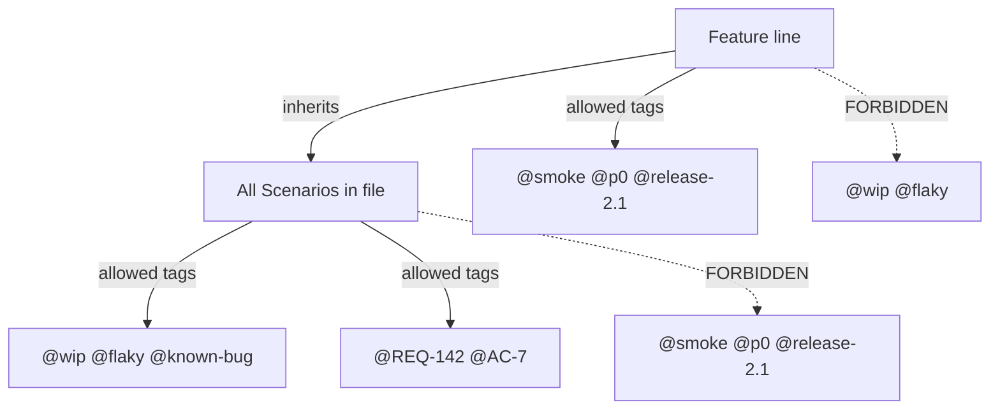

**Правило:** Теги `run_set` и `priority` ставятся **только** на строке `Feature`. Теги `state` и `traceability` ставятся **только** на строке `Scenario`. Никогда не дублируйте.

**Почему такое правило?**

1. **`run_set` и `priority` на Feature** — потому что они описывают **весь файл целиком**. Если файл `launch.feature` имеет `@smoke @p0`, то **все** сценарии в этом файле являются smoke-тестами с приоритетом p0. Ставить их на каждый Scenario — это дублирование, которое сложно поддерживать.

2. **`state` на Scenario** — потому что состояние может быть **разным для каждого сценария**. Один сценарий может быть `@wip` (ещё пишется), а другой — готов. Если бы state был на Feature, вы не могли бы иметь в одном файле и готовый сценарий, и WIP-сценарий.

3. **`traceability` на Scenario** — потому что разные сценарии могут покрывать **разные требования**. Один сценарий может быть связан с `@REQ-142`, другой — с `@REQ-143`. На уровне Feature это невозможно: Feature описывает одну业务能力, но сценарии внутри неё могут проверять разные аспекты.

**Пример правильного размещения:**

```gherkin
@smoke @p0 @release-2.1
Feature: Запуск браузера
  As a пользователь
  I want запустить браузер
  So that я могу выполнять тесты

  Scenario: Запуск headless Chromium
    @REQ-142
    Given чистое окружение
    When я запускаю Chromium в headless режиме
    Then браузер должен быть готов к навигации

  Scenario: Запуск с кастомным UA
    @REQ-142 @AC-7
    Given чистое окружение
    When я запускаю Chromium с user agent "Mozilla/5.0"
    Then браузер должен сообщить кастомный user agent

  Scenario: Запуск с viewport
    @wip
    Given чистое окружение
    When я запускаю Chromium с viewport "375x667"
    Then браузер должен сообщить viewport "375x667"
```

**Пример неправильного размещения:**

```gherkin
# ❌ Плохо: run_set на Scenario
@smoke
Feature: Запуск браузера
  As a пользователь
  I want запустить браузер
  So that я могу выполнять тесты

  Scenario: Запуск headless Chromium
    @smoke @p0 @release-2.1  # ❌ Дублирование!
    Given чистое окружение
    When я запускаю Chromium в headless режиме
    Then браузер должен быть готов к навигации

# ❌ Плохо: state на Feature
@wip
Feature: Запуск браузера
  As a пользователь
  I want запустить браузер
  So that я могу выполнять тесты

  Scenario: Запуск headless Chromium
    Given чистое окружение
    When я запускаю Chromium в headless режиме
    Then браузер должен быть готов к навигации
```

**Как CI проверяет это правило?**

Скрипт `qa/scripts/check-tag-placement.ts` парсит каждый `.feature` файл и проверяет:

1. На строке `Feature` есть только теги из групп `run_set`, `priority`, `release`.
2. На строке `Scenario` есть только теги из групп `state`, `traceability`.
3. Нет дублирования: если тег есть на Feature, он не должен быть на Scenario.
4. Все теги существуют в `qa/tag-schema.yaml`.

При нарушении — CI возвращает ошибку с указанием строки и тега.

### 6.4 Правила гранулярности шагов

Гранулярность шагов — это **главное правило**, которое отличает качественный BDD-тест от плохого. Ниже приведён полный набор правил, которые должны соблюдаться в каждом `.feature` файле.

```
┌─────────────────────────────────────────────────────────────────────┐
│  ПРАВИЛА GRANULARITY ШАГОВ                                          │
├─────────────────────────────────────────────────────────────────────┤
│  1. Один шаг = одно атомарное действие или утверждение               │
│  2. Максимум 5 шагов в блоке Given/When/Then                        │
│  3. Нет составных утверждений: "Then I see X and Y" → разбить       │
│  4. Нет скрытых предположений в When: "When I click the button"     │
│     (кнопка должна существовать) → добавить Given                    │
│  5. Нет деталей реализации в шагах: "When I call launch()"         │
│     → "When I launch the browser"                                   │
│  6. Использовать Scenario Outline для data-driven вариантов         │
│  7. Использовать Examples table для ≤ 10 строк; отдельные          │
│     Scenarios для > 10                                            │
└─────────────────────────────────────────────────────────────────────┘
```

**Разбор каждого правила:**

**Правило 1: Один шаг = одно атомарное действие или утверждение**

Это самое важное правило. «Атомарное» означает, что шаг проверяет **одну** вещь. Если шаг проверяет две вещи, он должен быть разбит на два.

| ❌ Плохо | ✅ Хорошо | Почему |
|---|---|---|
| `Then I see the error message and the button is disabled` | `Then I see the error message` + `Then the button is disabled` | Если первая проверка пройдёт, а вторая нет — вы не знаете, что именно упало. Раздельные проверки дают точный отчёт. |
| `When I click the button and fill the form` | `When I click the button` + `When I fill the form` | Если кнопка не кликается, вы не знаете, что форма не заполнена. Раздельные шаги дают точный отчёт. |
| `Then the page loads and shows the dashboard` | `Then the page loads` + `Then the dashboard is visible` | Если страница не загрузилась, проверка дашборда бессмысленна. Раздельные шаги позволяют отловить проблему загрузки. |

**Почему это важно?**

- **Точный отчёт:** Если тест упал, вы видите **какой именно** шаг упал. Не «тест упал», а «шаг 3 упал: кнопка не была отключена».
- **Легче отлаживать:** Можно запустить только один шаг и проверить его изолированно.
- **Легче читать:** Каждый шаг — это одно предложение. Легко понять, что происходит.

**Правило 2: Максимум 5 шагов в блоке Given/When/Then**

Если у вас больше 5 шагов в одном блоке — это признак того, что сценарий слишком сложный. Нужно разбить его на несколько сценариев.

| ❌ Плохо (7 шагов в Then) | ✅ Хорошо (разбито на 2 сценария) |
|---|---|
| `Then I see the header` | `Scenario: Заголовок отображается` |
| `And I see the navigation` | `Then I see the header` |
| `And I see the user menu` | `And I see the navigation` |
| `And I see the search bar` | `And I see the user menu` |
| `And I see the content area` | `And I see the search bar` |
| `And I see the footer` | `And I see the content area` |
| `And I see the sidebar` | `And I see the footer` |
| | |
| | `Scenario: Сайдбар отображается` |
| | `Then I see the sidebar` |

**Почему 5?**

Это эвристическое правило. 5 шагов — это максимум, который человек может удержать в голове при чтении. Если больше — сценарий становится «стеной текста», и его сложно читать, поддерживать и отлаживать.

**Правило 3: Нет составных утверждений**

Составное утверждение — это утверждение, которое проверяет **несколько** вещей одновременно. Его нужно разбить.

| ❌ Плохо | ✅ Хорошо |
|---|---|
| `Then the total is $100 and the tax is $10` | `Then the total is $100` + `Then the tax is $10` |
| `Then the user is logged in and the session is valid` | `Then the user is logged in` + `Then the session is valid` |
| `Then the page shows the error and the form is cleared` | `Then the page shows the error` + `Then the form is cleared` |

**Почему?**

- Если `total is $100` пройдёт, а `tax is $10` упадёт — вы не знаете, что именно не так.
- Если `user is logged in` пройдёт, а `session is valid` упадёт — вы не знаете, что именно не так.
- Раздельные проверки дают **точный** отчёт.

**Правило 4: Нет скрытых предположений в When**

Если в When-шаге есть **скрытое предположение** (что-то, что должно быть истинным, но не указано в Given), нужно добавить это предположение в Given.

| ❌ Плохо | ✅ Хорошо | Почему |
|---|---|---|
| `When I click the "Submit" button` | `Given the "Submit" button is visible` + `When I click the "Submit" button` | Если кнопка не видна, тест упадёт. Но вы не знаете, что именно не так: кнопка не существует, или она не видна, или она не кликабельна. |
| `When I navigate to /dashboard` | `Given the user is logged in` + `When I navigate to /dashboard` | Если пользователь не авторизован, навигация на /dashboard уйдёт на страницу логина. Тест упадёт, но вы не знаете, что именно не так. |
| `When I submit the form` | `Given the form is filled with valid data` + `When I submit the form` | Если форма не заполнена, отправка не сработает. Тест упадёт, но вы не знаете, что именно не так. |

**Почему это важно?**

- **Точный отчёт:** Если тест упал, вы видите **какой именно** шаг упал. Не «тест упал», а «шаг 1 упал: кнопка не видна».
- **Легче отлаживать:** Можно запустить только Given-шаг и проверить, что состояние системы правильное.
- **Легче читать:** Каждый Given-шаг — это одно предположение. Легко понять, что должно быть истинным перед началом сценария.

**Правило 5: Нет деталей реализации в шагах**

Шаги должны описывать **поведение**, а не **реализацию**. Не «как» система делает что-то, а «что» происходит.

| ❌ Плохо | ✅ Хорошо | Почему |
|---|---|---|
| `When I call launch()` | `When I launch the browser` | `launch()` — это функция кода. Если вы переименуете её, тест сломается. «Launch the browser» — это поведение. |
| `When I call api.get("/sessions")` | `When I request the session` | `api.get()` — это реализация. Если вы переключитесь на другой API, тест сломается. «Request the session» — это поведение. |
| `When I execute query "SELECT * FROM users"` | `When I fetch all users` | SQL-запрос — это реализация. Если вы переключитесь на другой запрос, тест сломается. «Fetch all users» — это поведение. |

**Почему это важно?**

- **Независимость от реализации:** Тест не зависит от того, как именно система реализована. Вы можете переписать внутреннюю реализацию, и тесты продолжат работать.
- **Понятность для бизнеса:** Бизнес-заказчик понимает «launch the browser», но не понимает «call launch()».
- **Переносимость:** Тест можно перенести на другую платформу, если поведение остаётся тем же.

**Правило 6: Использовать Scenario Outline для data-driven вариантов**

Если у вас есть несколько сценариев, которые отличаются только **данными**, используйте Scenario Outline.

| ❌ Плохо (3 отдельных сценария) | ✅ Хорошо (1 Scenario Outline) |
|---|---|
| `Scenario: Запуск с viewport 375x667` | `Scenario Outline: Запуск с viewport` |
| `When I launch with viewport "375x667"` | `When I launch with viewport "<width>x<height>"` |
| `Then I see viewport "375x667"` | `Then I see viewport "<width>x<height>"` |
| | |
| `Scenario: Запуск с viewport 768x1024` | `Examples:` |
| `When I launch with viewport "768x1024"` | `| width | height |` |
| `Then I see viewport "768x1024"` | `| 375   | 667    |` |
| | `| 768   | 1024   |` |
| `Scenario: Запуск с viewport 1920x1080` | `| 1920  | 1080   |` |
| `When I launch with viewport "1920x1080"` | |
| `Then I see viewport "1920x1080"` | |

**Почему это важно?**

- **Нет дублирования:** Один Scenario Outline вместо 3 отдельных сценариев.
- **Легче поддерживать:** Если вы меняете логику viewport, меняете один Scenario Outline, а не 3 сценария.
- **Легче читать:** Все варианты в одном месте. Легко увидеть, какие комбинации покрыты.

**Правило 7: Examples table для ≤ 10 строк, отдельные Scenarios для > 10**

Если у вас больше 10 строк в Examples table — это признак того, что сценарий слишком сложный. Нужно разбить его на несколько сценариев.

| ❌ Плохо (15 строк в Examples) | ✅ Хорошо (разбито на 2 сценария) |
|---|---|
| `Examples:` | `Scenario Outline: Запуск с viewport (мобильные)` |
| `| width | height |` | `Examples:` |
| `| 375   | 667    |` | `| width | height |` |
| `| 414   | 812    |` | `| 375   | 667    |` |
| `| 424   | 732    |` | `| 414   | 812    |` |
| `| 428   | 750    |` | `| 424   | 732    |` |
| `| 430   | 932    |` | `| 428   | 750    |` |
| `| 480   | 800    |` | `| 430   | 932    |` |
| `| 512   | 768    |` | `| 480   | 800    |` |
| `| 540   | 960    |` | `| 512   | 768    |` |
| `| 568   | 740    |` | `| 540   | 960    |` |
| `| 584   | 832    |` | `| 568   | 740    |` |
| `| 600   | 800    |` | `| 584   | 832    |` |
| `| 640   | 960    |` | `| 600   | 800    |` |
| `| 768   | 1024   |` | `| 640   | 960    |` |
| | | | |
| | | | `Scenario Outline: Запуск с viewport (планшеты и десктоп)` |
| | | | `Examples:` |
| | | | `| width | height |` |
| | | | `| 768   | 1024   |` |
| | | | `| 1024  | 768    |` |
| | | | `| 1280  | 720    |` |
| | | | `| 1366  | 768    |` |
| | | | `| 1920  | 1080   |` |
| | | | `| 2560  | 1440   |` |
| | | | `| 3840  | 2160   |` |

**Почему 10?**

Это эвристическое правило. 10 строк — это максимум, который человек может удержать в голове при чтении. Если больше — Examples table становится «стеной данных», и его сложно читать, поддерживать и отлаживать.

**Как CI проверяет эти правила?**

Скрипт `qa/scripts/check-step-granularity.ts` парсит каждый `.feature` файл и проверяет:

1. Каждый Given/When/Then блок содержит не более 5 шагов.
2. Нет составных утверждений (содержит `and`/`AND`/`и` в Then-шаге).
3. Нет скрытых предположений в When (содержит действие, которое должно быть в Given).
4. Нет деталей реализации в шагах (содержит вызов функций, SQL-запросы и т.д.).
5. Если есть несколько сценариев с одинаковой структурой, но разными данными — использовать Scenario Outline.
6. Если Examples table содержит больше 10 строк — разбить на несколько сценариев.

При нарушении — CI возвращает ошибку с указанием строки и правила.

---

## 7. Схема тест-кейса (Non-BDD)

> **Цель раздела:** Описать формат тест-кейсов для тестов, которые **не подходят** под Gherkin. Это API-тесты, performance-тесты, load-тесты и другие сценарии, где Gherkin-синтаксис был бы неестественным или избыточным.

### 7.0 Когда использовать Non-BDD формат?

Gherkin — это **язык поведения**. Он отлично подходит для сценариев «пользователь делает X, система делает Y». Но есть типы тестов, где Gherkin не работает:

| Тип теста | Почему Gherkin не подходит | Формат |
|---|---|---|
| API-тесты | Нет «пользователя», нет «поведения» — есть HTTP-запросы и ответы | YAML |
| Performance-тесты | Нет сценариев — есть метрики (RPS, latency, throughput) | YAML |
| Load-тесты | Нет сценариев — есть нагрузка (пользователи, запросы/сек) | YAML |
| Security-тесты | Нет сценариев — есть уязвимости и эксплойты | YAML |
| Chaos-тесты | Нет сценариев — есть сценарии сбоев (kill process, network partition) | YAML |

**Правило:** Если тест можно описать как «Given/When/Then» — используйте Gherkin. Если нет — используйте YAML-схему тест-кейса.

### 7.1 Пример тест-кейса (YAML)

```yaml
# qa/cases/api-launch.yaml
schema: "qa-test-case/v1"
id: "API-LAUNCH-001"
title: "Launch API returns 200 with browser session"
requirement:
  - "@REQ-142"
tags:
  run_set: ["api", "smoke"]
  priority: "p0"
  release: "release-2.1"
  state: []
  traceability: ["@REQ-142"]

preconditions:
  - "API server is running on :3000"
  - "Test environment is healthy"

steps:
  - id: "S1"
    action: "POST /api/launch"
    payload:
      headless: true
      browser: "chromium"
      viewport: "1920x1080"
    expected:
      status: 200
      body.session_id: "string"
      body.browser: "chromium"

  - id: "S2"
    action: "GET /api/sessions/{session_id}"
    expected:
      status: 200
      body.state: "ready"

  - id: "S3"
    action: "DELETE /api/sessions/{session_id}"
    expected:
      status: 204

postconditions:
  - "Session is cleaned up"

data:
  - "qa/data/launch-default.yaml"

environment:
  - "staging"

owner: "qa-team"
risk: "high"
```

**Разбор каждого поля:**

| Поле | Обязательность | Тип | Описание |
|---|---|---|---|
| `schema` | Да | string | Версия схемы. Должна быть `"qa-test-case/v1"`. При изменении схемы — новая версия. |
| `id` | Да | string | Уникальный идентификатор. Формат: `^[A-Z]+-[A-Z]+-[0-9]{3}$`. Например: `API-LAUNCH-001`. |
| `title` | Да | string | Краткое описание тест-кейса. 10–120 символов. |
| `requirement` | Да | array[string] | Массив тегов требований. Каждый элемент — `@REQ-XXX`. |
| `tags` | Да | object | Объект тегов (см. §6.2). Обязательные: `run_set`, `priority`. |
| `preconditions` | Нет | array[string] | Предусловия: что должно быть истинным до начала теста. |
| `steps` | Да | array[object] | Массив шагов. Каждый шаг: `id`, `action`, `expected`. |
| `postconditions` | Нет | array[string] | Постусловия: что должно быть истинным после конца теста. |
| `data` | Нет | array[string] | Путь к файлу данных. Формат: `qa/data/*.yaml`. |
| `environment` | Нет | array[string] | Среда: `dev`, `staging`, `prod`. |
| `owner` | Нет | string | Владелец: команда или роль. |
| `risk` | Нет | string | Уровень риска: `low`, `medium`, `high`. |

**Почему именно YAML, а не JSON?**

1. **Читаемость:** YAML легче читать для людей. JSON требует кавычек, скобок, запятых. YAML — это «чистый текст».
2. **Комментарии:** В YAML можно писать комментарии (`#`). В JSON — нельзя.
3. **Меньше шума:** В YAML нет кавычек вокруг строк (если не нужно), нет скобок, нет запятых. Меньше символов = меньше ошибок.
4. **Diff-ируемость:** YAML diff-ируется лучше, чем JSON. JSON diff показывает весь объект, YAML diff показывает только изменённые строки.

**Почему `id` имеет формат `^[A-Z]+-[A-Z]+-[0-9]{3}$`?**

- **Первая часть** (`API`) — тип теста. `API`, `PERF`, `LOAD`, `SEC`, `CHAOS`.
- **Вторая часть** (`LAUNCH`) —业务能力. `LAUNCH`, `NAVIGATE`, `AUTH`, `PAYMENT`.
- **Третья часть** (`001`) — порядковый номер. 3 цифры: от 001 до 999.

Это позволяет:
- **Группировать** тесты по типу и业务能力.
- **Сортировать** тесты по порядку.
- **Ссылаться** на тест в отчётах: «API-LAUNCH-001 упал».
- **Генерировать** ID автоматически: скрипт может найти максимальный номер и добавить 1.

**Почему `steps` — это массив объектов, а не строки?**

Потому что каждый шаг имеет **структуру**:
- `id` — идентификатор шага (S1, S2, S3).
- `action` — что делать (POST /api/launch, GET /api/sessions/{session_id}).
- `payload` — данные для запроса (headless: true, browser: chromium).
- `expected` — ожидаемый результат (status: 200, body.session_id: string).

Если бы шаги были строками, было бы невозможно:
- Проверить конкретное поле в ответе.
- Передавать данные между шагами (`{session_id}` из S1 в S2).
- Автоматически генерировать отчёт по шагам.

**Почему `expected` — это объект, а не строка?**

Потому что ожидаемый результат может быть **сложным**:
- `status: 200` — HTTP-статус.
- `body.session_id: "string"` — поле в теле ответа.
- `body.browser: "chromium"` — конкретное значение поля.
- `headers.content-type: "application/json"` — заголовок.
- `body.items.length: 5` — длина массива.

Если бы `expected` был строкой, было бы невозможно:
- Проверить конкретное поле.
- Проверить тип данных.
- Проверить длину массива.
- Автоматически генерировать отчёт.

**Почему `data` — это путь к файлу, а не данные?**

Потому что данные должны быть **отдельны** от логики теста. Это позволяет:
- **Переиспользовать** данные в разных тестах.
- **Менять** данные без изменения логики теста.
- **Генерировать** данные автоматически (например, случайные email-адреса).
- **Валидировать** данные отдельно (JSON Schema).

**Почему `environment` — это массив, а не строка?**

Потому что тест может запускаться в **нескольких** средах одновременно:
- `["staging", "prod"]` — тест должен пройти в staging и prod.
- `["dev"]` — тест только для dev.
- `[]` — тест для любой среды.

Это позволяет CI-системе:
- Запускать тест в нужных средах.
- Пропускать тест, если среда недоступна.
- Генерировать отчёт по средам.

**Почему `owner` и `risk` — это опциональные поля?**

Потому что:
- **`owner`** может быть неизвестен на момент создания теста. Его можно добавить позже.
- **`risk`** может быть оценён позже, после того как тест будет написан и будет понятен его уровень риска.

Но **рекомендация:** заполняйте их как можно раньше. Чем раньше вы оцените риск и назначите владельца, тем быстрее вы сможете реагировать на сбой.

### 7.2 JSON Schema для валидации тест-кейсов

Все тест-кейсы в `qa/cases/*.yaml` должны валидироваться против `qa/schemas/test-case.schema.json` в CI.

```json
{
  "$schema": "http://json-schema.org/draft-07/schema#",
  "title": "QA Test Case v1",
  "type": "object",
  "required": ["id", "title", "requirement", "tags", "steps"],
  "properties": {
    "id": {
      "type": "string",
      "pattern": "^[A-Z]+-[A-Z]+-[0-9]{3}$"
    },
    "title": {
      "type": "string",
      "minLength": 10,
      "maxLength": 120
    },
    "requirement": {
      "type": "array",
      "minItems": 1,
      "items": {
        "type": "string",
        "pattern": "^@REQ-[0-9]+$"
      }
    },
    "tags": {
      "type": "object",
      "required": ["run_set", "priority"],
      "properties": {
        "run_set": {
          "type": "array",
          "minItems": 1,
          "items": {
            "enum": ["smoke", "regression", "e2e", "api", "integration"]
          }
        },
        "priority": {
          "enum": ["p0", "p1", "p2"]
        },
        "release": {
          "type": "string",
          "pattern": "^release-[0-9]+\\.[0-9]+$"
        },
        "state": {
          "type": "array",
          "items": {
            "enum": ["wip", "flaky", "known-bug"]
          }
        },
        "traceability": {
          "type": "array",
          "items": {
            "pattern": "^@(REQ|AC)-[0-9]+$"
          }
        }
      }
    },
    "steps": {
      "type": "array",
      "minItems": 1,
      "maxItems": 20,
      "items": {
        "type": "object",
        "required": ["id", "action", "expected"],
        "properties": {
          "id": { "type": "string", "pattern": "^S[0-9]+$" },
          "action": { "type": "string" },
          "payload": { "type": "object" },
          "expected": { "type": "object" }
        }
      }
    },
    "preconditions": {
      "type": "array",
      "items": { "type": "string" }
    },
    "postconditions": {
      "type": "array",
      "items": { "type": "string" }
    },
    "data": {
      "type": "array",
      "items": {
        "type": "string",
        "pattern": "^qa/data/.*\\.yaml$"
      }
    },
    "environment": {
      "type": "array",
      "items": {
        "enum": ["dev", "staging", "prod"]
      }
    },
    "owner": {
      "type": "string"
    },
    "risk": {
      "enum": ["low", "medium", "high"]
    }
  }
}
```

**Разбор каждого правила валидации:**

| Правило | Значение | Почему |
|---|---|---|
| `required: ["id", "title", "requirement", "tags", "steps"]` | Эти поля обязательны | Без них тест-кейс не имеет смысла. |
| `id.pattern: "^[A-Z]+-[A-Z]+-[0-9]{3}$"` | ID должен соответствовать формату | Единый формат позволяет группировать, сортировать, ссылаться. |
| `title.minLength: 10` | Заголовок минимум 10 символов | Короткие заголовки (`"Test"`, `"API"`) не информативны. |
| `title.maxLength: 120` | Заголовок максимум 120 символов | Длинные заголовки не читаются в отчётах. |
| `requirement.minItems: 1` | Минимум одно требование | Тест без требования — это «орфан», который никто не знает, зачем нужен. |
| `requirement.items.pattern: "^@REQ-[0-9]+$"` | Требование должно быть `@REQ-XXX` | Единый формат позволяет связать тест с тикетом. |
| `tags.required: ["run_set", "priority"]` | run_set и priority обязательны | Без них CI не знает, когда запускать тест и насколько он критичен. |
| `tags.run_set.items.enum` | run_set должен быть из списка | Неизвестные run_set ломают CI. |
| `tags.priority.enum` | priority должен быть из списка | Неизвестные priority ломают CI. |
| `steps.minItems: 1` | Минимум один шаг | Тест без шагов — это не тест. |
| `steps.maxItems: 20` | Максимум 20 шагов | Тест с больше 20 шагов слишком сложный. |
| `steps.items.required: ["id", "action", "expected"]` | Каждый шаг должен иметь id, action, expected | Без expected тест не проверяет ничего. |
| `steps.items.id.pattern: "^S[0-9]+$"` | ID шага должен быть `S1`, `S2`, ... | Единый формат позволяет ссылаться на шаги в отчётах. |
| `data.items.pattern: "^qa/data/.*\\.yaml$"` | Данные должны быть в `qa/data/*.yaml` | Единый каталог данных позволяет валидировать их отдельно. |
| `environment.items.enum` | Среда должна быть из списка | Неизвестные среды ломают CI. |
| `risk.enum` | Риск должен быть из списка | Неизвестные риски ломают CI. |

**Почему валидация в CI?**

1. **Быстрая обратная связь:** Если вы написали тест-кейс с ошибкой, CI скажет об этом через 10 секунд, а не через час.
2. **Единый стандарт:** Все тест-кейсы в проекте соответствуют одной схеме.
3. **Автоматизация:** Скрипты могут парсить тест-кейсы и генерировать отчёты, traceability, coverage.
4. **Защита от ошибок:** Если вы забыли `expected` в шаге, CI не даст вам merge.

**Как CI проверяет валидацию?**

```bash
# В .github/workflows/test.yml
- run: npx ajv validate qa/schemas/test-case.schema.json qa/cases/*.yaml
```

Скрипт `ajv` (JSON Schema validator) проверяет каждый файл в `qa/cases/*.yaml` против схемы. Если есть ошибка — CI возвращает ошибку с указанием файла, поля и правила.

**Пример ошибки:**

```
Error: qa/cases/api-launch.yaml:
  - id: "API-LAUNCH-001" — OK
  - title: "Launch API returns 200" — OK
  - requirement: ["@REQ-142"] — OK
  - tags: { run_set: ["api"], priority: "p0" } — OK
  - steps: [
      { id: "S1", action: "POST /api/launch", expected: { status: 200 } } — OK
      { id: "S2", action: "GET /api/sessions/{session_id}" } — ❌ Missing "expected"
    ]
```

**Почему это важно?**

- **Качество:** Тест-кейсы без `expected` не проверяют ничего. Они просто «выполняются» и «проходят».
- **Понятность:** Единый формат позволяет любому члену команды понять структуру тест-кейса.
- **Автоматизация:** Скрипты могут парсить тест-кейсы и генерировать отчёты, traceability, coverage.
- **Защита от ошибок:** Если вы забыли поле, CI не даст вам merge.

---

## 8. Стратегия тестовых данных

> **Цель раздела:** Описать, как организованы, классифицируются и используются тестовые данные в проекте. Этот раздел отвечает на вопрос: «Где хранятся данные, как они классифицируются и как они используются в тестах?»

### 8.1 Классификация данных

Тестовые данные делятся на **4 категории** в зависимости от того, откуда они берутся и как изменяются:

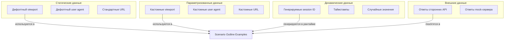

**Разбор каждой категории:**

| Категория | Что это | Пример | Где хранится | Как используется |
|---|---|---|---|---|
| **Статические** | Данные, которые **не меняются** никогда | Дефолтный viewport 1920x1080, дефолтный UA, стандартные URL | `qa/data/*.yaml` | В Examples table Scenario Outline |
| **Параметризованные** | Данные, которые **меняются** в зависимости от сценария | Кастомные viewport (375x667, 768x1024), кастомные UA | `qa/data/*.yaml` | В Examples table Scenario Outline |
| **Динамические** | Данные, которые **генерируются** в момент выполнения | Session ID, таймстампы, случайные email | В коде (step definitions) | В рантайме, при каждом запуске |
| **Внешние** | Данные, которые **приходят извне** | Ответы сторонних API, данные от mock-сервера | Mock-сервер / API | В рантайме, при каждом запуске |

**Почему важно разделять эти категории?**

1. **Статические и параметризованные** — хранятся в файлах. Их можно:
   - Валидировать (JSON Schema).
   - Менять без изменения кода.
   - Переиспользовать в разных тестах.
   - Diff-ировать в Git.

2. **Динамические** — генерируются в коде. Их нельзя хранить в файлах, потому что:
   - Они должны быть уникальными при каждом запуске (session ID).
   - Они зависят от времени (таймстампы).
   - Они должны быть случайными (случайные email).

3. **Внешние** — приходят извне. Их нельзя контролировать полностью, поэтому:
   - Их нужно mock'ить (заменять на предсказуемые значения).
   - Их нужно валидировать (проверять, что ответ имеет ожидаемую структуру).
   - Их нужно изолировать (чтобы тест не зависел от внешнего сервиса).

**Правило:** Все тестовые данные должны быть в `qa/data/*.yaml`. Никаких захардкоженных значений в `.feature` файлах или step definitions.

**Почему это важно?**

- **Нет захардкоженных значений:** Если вы меняете дефолтный viewport с 1920x1080 на 2560x1440, вы меняете один файл, а не 50 feature-файлов.
- **Валидация:** Скрипты могут проверить, что все данные в `qa/data/*.yaml` соответствуют схеме.
- **Переиспользование:** Один файл данных может использоваться в разных тестах.
- **Diff-ируемость:** Изменения данных видны в git diff.

### 8.2 Схема файла данных

```yaml
# qa/data/viewport-variants.yaml
schema: "qa-test-data/v1"
name: "viewport-variants"
description: "Размеры viewport для cross-device тестирования"
items:
  - id: "vp-mobile"
    width: 375
    height: 667
    label: "iPhone SE"
  - id: "vp-tablet"
    width: 768
    height: 1024
    label: "iPad"
  - id: "vp-desktop"
    width: 1920
    height: 1080
    label: "Desktop 1080p"
  - id: "vp-4k"
    width: 3840
    height: 2160
    label: "4K Monitor"
```

**Разбор каждого поля:**

| Поле | Обязательность | Тип | Описание |
|---|---|---|---|
| `schema` | Да | string | Версия схемы данных. Должна быть `"qa-test-data/v1"`. |
| `name` | Да | string | Имя набора данных. Используется для ссылок. |
| `description` | Да | string | Описание: что это за данные и зачем они нужны. |
| `items` | Да | array[object] | Массив элементов данных. |
| `items[].id` | Да | string | Уникальный идентификатор элемента. |
| `items[].width` | Да | number | Ширина viewport. |
| `items[].height` | Да | number | Высота viewport. |
| `items[].label` | Да | string | Человеческое имя (для отчётов). |

**Почему `id` и `label` — это разные поля?**

- **`id`** — это **машинное** имя. Используется в коде и данных. Должно быть:
  - Коротким.
  - Без пробелов.
  - Без кириллицы.
  - Уникальным.
  - Пример: `vp-mobile`, `vp-tablet`, `vp-desktop`.

- **`label`** — это **человеческое** имя. Используется в отчётах и UI. Может быть:
  - Длинным.
  - С пробелами.
  - С кириллицей.
  - Не уникальным (два элемента могут иметь один label).
  - Пример: «iPhone SE», «iPad», «Desktop 1080p».

**Почему данные в YAML, а не в JSON?**

1. **Читаемость:** YAML легче читать для людей.
2. **Комментарии:** В YAML можно писать комментарии.
3. **Меньше шума:** В YAML нет кавычек, скобок, запятых.
4. **Diff-ируемость:** YAML diff-ируется лучше, чем JSON.

**Почему данные в отдельном файле, а не в feature-файле?**

1. **Переиспользование:** Один файл данных может использоваться в разных feature-файлах.
2. **Валидация:** Данные можно валидировать отдельно (JSON Schema).
3. **Изменения:** Можно менять данные без изменения логики теста.
4. **Генерация:** Можно генерировать данные автоматически (например, случайные email).

**Правило:** Все тестовые данные должны быть в `qa/data/*.yaml`. Никаких захардкоженных значений в `.feature` файлах или step definitions.

**Пример использования данных в feature-файле:**

```gherkin
@smoke @p0 @release-2.1
Feature: Запуск браузера с viewport
  As a пользователь
  I want запустить браузер с кастомным viewport
  So that я могу проверить кросс-девайс отображение

  Scenario Outline: Запуск с viewport
    Given чистое окружение
    When я запускаю Chromium с viewport "<width>x<height>"
    Then браузер должен сообщить viewport "<width>x<height>"

    Examples:
      | width | height |
      | 375   | 667    |
      | 768   | 1024   |
      | 1920  | 1080   |
      | 3840  | 2160   |
```

Здесь данные берутся из `qa/data/viewport-variants.yaml`. Если вы добавите новый viewport в этот файл, он автоматически появится в Examples table (через скрипт генерации).

**Как CI проверяет данные?**

```bash
# В .github/workflows/test.yml
- run: npx ajv validate qa/schemas/test-data.schema.json qa/data/*.yaml
```

Скрипт `ajv` проверяет каждый файл в `qa/data/*.yaml` против схемы. Если есть ошибка — CI возвращает ошибку с указанием файла, поля и правила.

**Пример ошибки:**

```
Error: qa/data/viewport-variants.yaml:
  - schema: "qa-test-data/v1" — OK
  - name: "viewport-variants" — OK
  - description: "Viewport sizes for cross-device testing" — OK
  - items: [
      { id: "vp-mobile", width: 375, height: 667, label: "iPhone SE" } — OK
      { id: "vp-tablet", width: 768, height: 1024, label: "iPad" } — OK
      { id: "vp-desktop", width: 1920, height: 1080, label: "Desktop 1080p" } — OK
      { id: "vp-4k", width: 3840, height: 2160, label: "4K Monitor" } — OK
    ] — OK
```

**Почему это важно?**

- **Качество:** Данные валидированы. Нет ошибок в данных.
- **Понятность:** Единый формат позволяет любому члену команды понять структуру данных.
- **Автоматизация:** Скрипты могут парсить данные и генерировать Examples table.
- **Защита от ошибок:** Если вы забыли поле, CI не даст вам merge.

---

## 9. Матрица трассируемости (Traceability Matrix)

> **Цель раздела:** Описать, как связываются требования, feature-файлы, сценарии и тест-кейсы в единой матрице. Этот раздел отвечает на вопрос: «Как проверить, что каждое требование покрыто тестами, и как найти, какие требования не покрыты?»

### 9.1 Структура матрицы

Матрица трассируемости — это **CSV-файл**, который связывает все уровни тестовой иерархии:

```csv
# qa/traceability.csv
requirement_id,requirement_title,capability,feature_file,scenario_id,scenario_title,test_case_id,test_case_title,owner,risk,status
REQ-142,Browser launch,launch,features/browser/launch.feature,SC-LAUNCH-001,Launch headless Chromium,,API-LAUNCH-001,Launch API returns 200,qa-team,high,pass
REQ-142,Browser launch,launch,features/browser/launch.feature,SC-LAUNCH-002,Launch with custom user agent,,API-LAUNCH-002,Launch API with custom UA,qa-team,high,pass
REQ-143,Navigation,navigate,features/browser/navigate.feature,SC-NAV-001,Navigate to URL,,,,qa-team,medium,pending
```

**Разбор каждого столбца:**

| Столбец | Обязательность | Описание |
|---|---|---|
| `requirement_id` | Да | ID требования (REQ-XXX). Ссылка на тикет Jira/Linear. |
| `requirement_title` | Да | Заголовок требования. |
| `capability` | Да |业务能力 (например, `launch`, `navigate`). |
| `feature_file` | Да | Путь к feature-файлу. |
| `scenario_id` | Да | ID сценария (SC-XXX-NNN). |
| `scenario_title` | Да | Заголовок сценария. |
| `test_case_id` | Нет | ID тест-кейса (Non-BDD). Пусто, если тест — Gherkin. |
| `test_case_title` | Нет | Заголовок тест-кейса. Пусто, если тест — Gherkin. |
| `owner` | Да | Владелец: команда или роль. |
| `risk` | Да | Уровень риска: `low`, `medium`, `high`. |
| `status` | Да | Статус: `pass`, `fail`, `pending`, `skipped`. |

**Почему CSV, а не YAML или JSON?**

1. **Простота:** CSV можно открыть в Excel, Google Sheets, VS Code.
2. **Сортировка:** Легко отсортировать по любому столбцу.
3. **Фильтрация:** Легко отфильтровать по требованию, статусу, риску.
4. **Интеграция:** CSV можно импортировать в TMS, Jira, Excel.
5. **Diff-ируемость:** CSV diff-ируется хорошо в Git.

**Почему матрица — это **генерируемый** файл, а не ручной?**

1. **Нет ручных ошибок:** Если вы добавили сценарий в feature-файл, матрица обновится автоматически.
2. **Нет рассинхронизации:** Матрица всегда актуальна, потому что генерируется из исходных файлов.
3. **Автоматизация:** Скрипт генерирует матрицу из `.feature` файлов и `qa/cases/*.yaml`.
4. **CI:** Матрица генерируется в CI и проверяется на ошибки.

**Как генерируется матрица?**

```bash
# CI: generate traceability matrix
npx ts-node qa/scripts/generate-traceability.ts \
  --features "features/**/*.feature" \
  --cases "qa/cases/*.yaml" \
  --output "qa/traceability.csv"
```

Скрипт:
1. Парсит все `.feature` файлы.
2. Извлекает теги `@REQ-XXX` и `@AC-XXX`.
3. Парсит все `qa/cases/*.yaml`.
4. Извлекает `requirement` и `tags.traceability`.
5. Связывает данные в CSV.
6. Записывает результат в `qa/traceability.csv`.

**Почему это важно?**

- **Полное покрытие:** Можно проверить, что каждое требование имеет хотя бы один сценарий.
- **Быстрый поиск:** Можно найти все сценарии для конкретного требования.
- **Отчётность:** Можно сгенерировать отчёт по покрытию требований.
- **Автоматизация:** Матрица всегда актуальна, без ручного обновления.

### 9.2 Правила трассируемости

```mermaid
flowchart LR
    R[Требование] -->|1:N| F[Feature File]
    F -->|1:N| S[Scenario]
    S -->|1:N| TC[Test Case]
    TC -->|1:1| SD[Step Definition]
    TC -->|1:N| D[Test Data]

    R -.->|@REQ-XXX| F
    F -.->|@REQ-XXX| S
    S -.->|@REQ-XXX| TC
    TC -.->|@REQ-XXX| SD
```

**Иерархия трассируемости:**

```
Требование (REQ-142)
  └── Feature File (features/browser/launch.feature)
        └── Scenario (SC-LAUNCH-001)
              └── Test Case (API-LAUNCH-001)
                    └── Step Definition (S1, S2, S3)
                    └── Test Data (qa/data/launch-default.yaml)
```

**Правила:**

1. **Каждое требование должно иметь хотя бы один сценарий.** Если нет — это **coverage gap**.
2. **Каждый сценарий должен быть связан с хотя бы одним требованием.** Если нет — это **orphan scenario**.
3. **Каждый тест-кейс должен быть связан с хотя бы одним требованием.** Если нет — это **orphan test case**.
4. **Каждый сценарий может быть связан с несколькими требованиями.** Это нормально: один сценарий может проверять несколько аспектов требования.
5. **Каждое требование может быть связано с несколькими сценариями.** Это нормально: одно требование может проверяться разными сценариями.

**Почему это важно?**

- **Полное покрытие:** Нет требований без тестов.
- **Нет орфанов:** Нет сценариев без требований.
- **Понятность:** Можно проследить путь от требования до конкретного шага.
- **Отчётность:** Можно сгенерировать отчёт по покрытию.

### 9.3 Coverage Gaps (Пробелы покрытия)

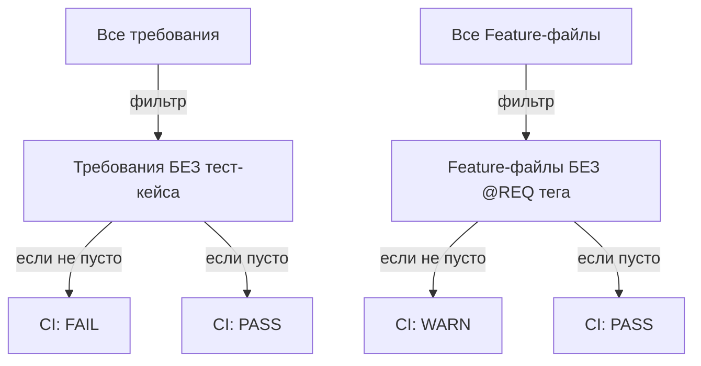

**Правило:** CI **падает** (FAIL), если любое требование не имеет тест-кейса. CI **предупреждает** (WARN), если любой feature-файл не имеет тега `@REQ`.

**Почему FAIL для требований без тестов?**

Потому что если требование не покрыто тестами, то:
- Вы не знаете, что оно работает.
- Вы не знаете, что оно не сломалось.
- Вы не можете гарантировать качество релиза.

**Почему WARN для feature-файлов без @REQ?**

Потому что:
- Feature-файл может быть **WIP** (в работе).
- Feature-файл может быть **документацией** (не исполняемый).
- Feature-файл может быть **тестом на поведение**, которое не связано с конкретным требованием.

Но **рекомендация:** заполняйте `@REQ` как можно раньше. Чем раньше вы свяжете сценарий с требованием, тем быстрее вы сможете проверить покрытие.

**Как CI проверяет coverage gaps?**

```bash
# В .github/workflows/test.yml
- run: npx ts-node qa/scripts/check-coverage.ts
```

Скрипт:
1. Читает `qa/traceability.csv`.
2. Проверяет, что каждое требование имеет хотя бы один сценарий.
3. Проверяет, что каждый feature-файл имеет тег `@REQ`.
4. Если есть пробелы — возвращает ошибку.

**Пример ошибки:**

```
Error: Coverage gaps found:
  - REQ-145: "Payment processing" — no test case
  - REQ-146: "User profile" — no test case
  - features/browser/payment.feature — no @REQ tag
```

**Почему это важно?**

- **Качество:** Нет требований без тестов.
- **Полное покрытие:** Все требования покрыты.
- **Автоматизация:** Пробелы обнаруживаются автоматически.
- **Защита от ошибок:** Если вы забыли связать сценарий с требованием, CI не даст вам merge.

---

## 10. Реестр рисков (Risk Register)

> **Цель раздела:** Описать, как идентифицируются, оцениваются и отслеживаются риски, связанные с тестированием. Этот раздел отвечает на вопрос: «Какие риски существуют, насколько они критичны и что мы делаем, чтобы их минимизировать?»

### 10.1 Структура реестра

Реестр рисков — это **Markdown-таблица** в файле `qa/risk-register.md`:

```markdown
# qa/risk-register.md

| ID   | Описание риска              | Вероятность (1-5) | Влияние (1-5) | Счёт | Митигация                          | Владелец   | Статус   |
|------|-------------------------------|------------------|--------------|-------|-------------------------------------|---------|----------|
| R-01 | Нестабильный запуск браузера  | 3                | 4            | 12    | @flaky тег + тикет на исправление   | qa-team | open     |
| R-02 | Таймаут на медленных CI-раннерах | 4            | 3            | 12    | Увеличить таймаут до 30 сек         | dev     | open     |
| R-03 | Отсутствие тестовых данных для новой среды | 2 | 5            | 10    | Добавить файл данных для каждой среды | qa-team | open     |
| R-04 | Пробел покрытия в навигации  | 3                | 3            | 9     | Добавить сценарии для edge cases     | qa-team | open     |
```

**Разбор каждого столбца:**

| Столбец | Тип | Описание |
|---|---|---|
| `ID` | string | Уникальный идентификатор риска. Формат: `R-XX` (R + 2 цифры). |
| `Описание риска` | string | Краткое описание: что может пойти не так. |
| `Вероятность (1-5)` | number | Насколько вероятно, что риск материализуется. 1 = почти никогда, 5 = почти наверняка. |
| `Влияние (1-5)` | number | Насколько критично, если риск материализуется. 1 = незначительно, 5 = критично. |
| `Счёт` | number | `Score = Вероятность × Влияние`. |
| `Митигация` | string | Что мы делаем, чтобы снизить риск. |
| `Владелец` | string | Кто отвечает за митигацию. |
| `Статус` | string | `open` (открыт), `mitigated` (снизен), `closed` (закрыт). |

**Почему именно 5-балльная шкала?**

- **Простота:** 5 значений — это максимум, который человек может удержать в голове.
- **Достаточная гранулярность:** 5 значений позволяют различать «почти никогда» от «почти наверняка».
- **Умножение:** `Score = Вероятность × Влияние` даёт диапазон от 1 до 25. Это позволяет ранжировать риски.

**Почему `Score = Вероятность × Влияние`?**

Потому что:
- Высокая вероятность + высокое влияние = критичный риск (Score = 25).
- Высокая вероятность + низкое влияние = умеренный риск (Score = 5).
- Низкая вероятность + высокое влияние = умеренный риск (Score = 5).
- Низкая вероятность + низкое влияние = незначительный риск (Score = 1).

Это позволяет **ранжировать** риски: сначала работаем с самыми критичными (высокий Score), потом — с менее критичными.

**Порог:** `Score ≥ 10` = высокий риск, требует митигации до релиза.

| Score | Уровень | Действие |
|---|---|---|
| 1–4 | Низкий | Отслеживать, не блокирует релиз |
| 5–9 | Средний | Отслеживать, митигация желательна |
| 10–14 | Высокий | Митигация обязательна до релиза |
| 15–25 | Критический | Митигация обязательна, блокирует релиз |

**Почему это важно?**

- **Приоритизация:** Можно сосредоточиться на самых критичных рисках.
- **Прозрачность:** Все видят, какие риски существуют и кто за них отвечает.
- **Отчётность:** Можно сгенерировать отчёт по рискам для руководства.
- **Автоматизация:** Скрипты могут проверять, что все риски с Score ≥ 10 имеют митигацию.

**Как обновлять реестр?**

1. **При обнаружении нового риска:** Добавьте строку в таблицу.
2. **При снижении риска:** Обновите `Вероятность` или `Влияние`, пересчитайте `Score`.
3. **При закрытии риска:** Измените `Статус` на `closed`.
4. **Раз в спринт:** Проведите review реестра. Уберите закрытые риски, добавьте новые.

**Почему реестр — это Markdown, а не CSV?**

1. **Читаемость:** Markdown-таблица легче читается в VS Code и GitHub.
2. **Комментарии:** Можно добавить комментарии к рискам.
3. **Review:** Markdown-таблица легче review'ить в PR.
4. **Документация:** Реестр — это документ, а не данные. Markdown подходит лучше.

---

## 11. Критерии входа / выхода (Entry / Exit Criteria)

> **Цель раздела:** Описать условия, при которых можно **начать** тестирование (Entry Criteria) и условия, при которых можно **выпустить** релиз (Exit Criteria). Этот раздел отвечает на вопрос: «Когда мы начинаем тестировать и когда мы готовы к релизу?»

### 11.1 Критерии входа (Entry Criteria)

Критерии входа — это **условия**, которые должны быть выполнены **до начала** E2E-тестирования. Если они не выполнены — E2E-тестирование не начинается.

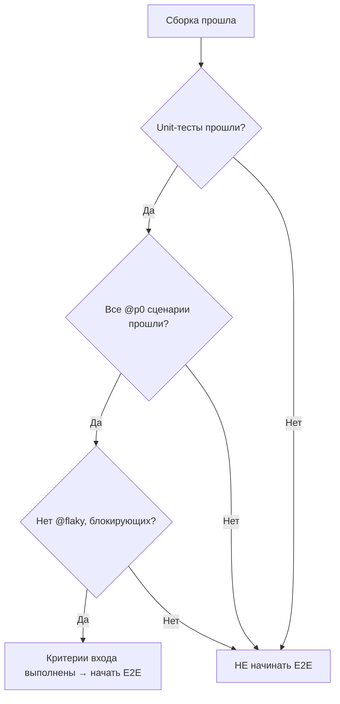

**Разбор каждого условия:**

| # | Условие | Почему важно |
|---|---|---|
| 1 | **Сборка прошла** | Если сборка не прошла, нет кода для тестирования. |
| 2 | **Unit-тесты прошли** | Если unit-тесты не прошли, код содержит базовые ошибки. Нет смысла запускать E2E. |
| 3 | **Все @p0 сценарии прошли** | Если p0-сценарии не прошли, критичные функции не работают. Нет смысла запускать полный E2E. |
| 4 | **Нет @flaky, блокирующих** | Если есть нестабильные тесты, они могут «кричать» ложные сбой. Нужно сначала их исправить. |

**Почему именно эти 4 условия?**

1. **Сборка прошла** — это **минимум**. Без сборки нет кода.
2. **Unit-тесты прошли** — это **быстрая проверка**. Unit-тесты запускаются за секунды. Если они не прошли, нет смысла тратить минуты на E2E.
3. **Все @p0 сценарии прошли** — это **критичность**. P0-сценарии — это самые важные. Если они не прошли, релиз невозможен.
4. **Нет @flaky, блокирующих** — это **надёжность**. Нестабильные тесты ломают доверие к CI. Нужно сначала их исправить.

**Почему это важно?**

- **Эффективность:** Не тратим время на E2E, если unit-тесты не прошли.
- **Надёжность:** Не запускаем E2E, если есть нестабильные тесты.
- **Критичность:** Не запускаем E2E, если p0-сценарии не прошли.
- **Автоматизация:** CI автоматически проверяет эти условия и решает, запускать ли E2E.

**Как CI проверяет критерии входа?**

```bash
# В .github/workflows/test.yml
- run: npm test  # Unit-тесты
- run: npx cucumber --tags "@p0 and not @wip" --format allure  # P0-сценарии
- run: npx ts-node qa/scripts/check-flaky.ts  # Проверка @flaky
```

Если любое из условий не выполнено — CI возвращает ошибку и не запускает E2E.

### 11.2 Критерии выхода (Exit Criteria)

Критерии выхода — это **условия**, которые должны быть выполнены **до выпуска** релиза. Если они не выполнены — релиз не выпускается.

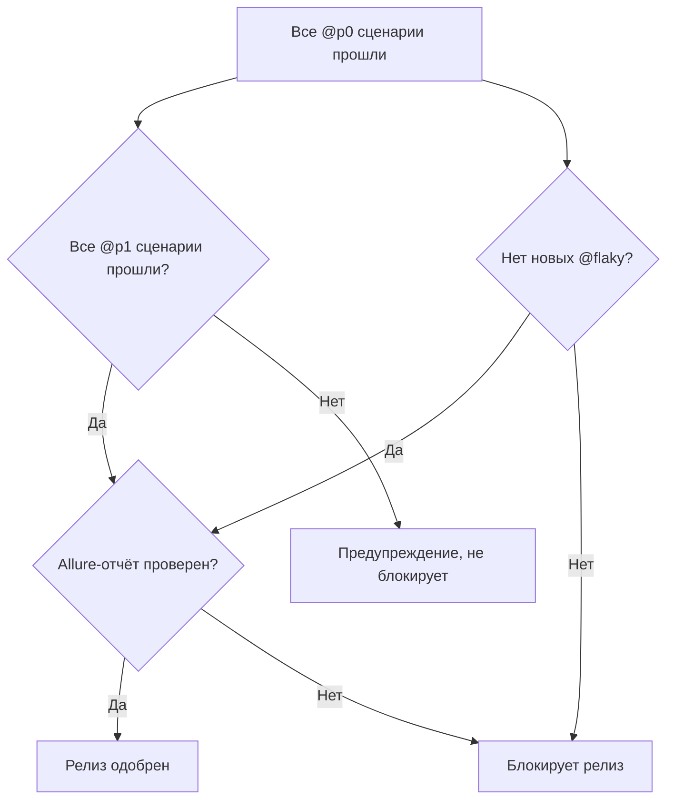

**Разбор каждого условия:**

| # | Условие | Почему важно |
|---|---|---|
| 1 | **Все @p0 сценарии прошли** | P0-сценарии — это критичные. Если они не прошли, релиз невозможен. |
| 2 | **Все @p1 сценарии прошли** | P1-сценарии — это важные. Если они не прошли, нужно предупредить, но не блокировать. |
| 3 | **Нет новых @flaky** | Если появились новые нестабильные тесты, нужно их исправить до релиза. |
| 4 | **Allure-отчёт проверен** | Нужно убедиться, что все сбои разобраны и не являются критичными. |

**Почему p1 — это WARN, а не FAIL?**

Потому что:
- P1-сценарии — это **важные**, но не **критичные**.
- Если p1 упал, можно выпустить релиз, но нужно исправить в ближайшем спринте.
- Если p0 упал, релиз невозможен.

**Почему новые @flaky — это FAIL?**

Потому что:
- Новые нестабильные тесты ломают доверие к CI.
- Если тест нестабильный, он может «кричать» ложные сбой.
- Нужно сначала исправить нестабильность, а потом выпускать релиз.

**Почему Allure-отчёт — это обязательное условие?**

Потому что:
- Allure-отчёт показывает все сбои и их причины.
- Нужно убедиться, что все сбои разобраны.
- Нужно убедиться, что нет скрытых проблем.
- Это **документация** для руководства: что было проверено и что найдено.

**Почему это важно?**

- **Качество:** Релиз только если все критичные тесты прошли.
- **Надёжность:** Релиз только если нет новых нестабильных тестов.
- **Документация:** Allure-отчёт — это документация для руководства.
- **Автоматизация:** CI автоматически проверяет эти условия и решает, выпускать ли релиз.

**Как CI проверяет критерии выхода?**

```bash
# В .github/workflows/test.yml (при merge в main)
- run: npx cucumber --tags "(@e2e and not @wip and not @flaky)" --format allure  # Полный E2E
- run: npx ts-node qa/scripts/check-flaky.ts  # Проверка новых @flaky
- run: npx ts-node qa/scripts/check-allure.ts  # Проверка Allure-отчёта
```

Если любое из условий не выполнено — CI возвращает ошибку и не выпускает релиз.

---

## 12. CI Pipeline (Исполнение)

> **Цель раздела:** Описать полный цикл CI/CD для тестирования — от открытия PR до выпуска релиза. Этот раздел отвечает на вопрос: «Что происходит в CI при каждом PR, merge и релизе?»

### 12.1 Архитектура пайплайна

```mermaid
flowchart TD
    subgraph "PR"
        A[PR открыт] --> B[Gherkin Lint]
        B --> C{Lint прошёл?}
        C -->|Нет| FAIL[PR: FAIL]
        C -->|Да| D[Unit-тесты]
        D --> E{Unit прошёл?}
        E -->|Нет| FAIL
        E -->|Да| F[Smoke E2E]
        F --> G{Smoke прошёл?}
        G -->|Нет| FAIL
        G -->|Да| H[Tag Audit]
        H --> I{Tag audit прошёл?}
        I -->|Нет| WARN[PR: WARN]
        I -->|Да| J[Allure Report]
        J --> K[PR: PASS]
    end

    subgraph "Merge в main"
        L[Merge] --> M[Полный Regression]
        M --> N{Regression прошёл?}
        N -->|Нет| FAIL2[Блокирует merge]
        N -->|Да| O[Allure Report]
        O --> P[Release Candidate]
    end

    subgraph "Release"
        Q[Release X.Y] --> R[Release Plan]
        R --> S{Все @release-X.Y прошли?}
        S -->|Нет| FAIL3[Блокирует релиз]
        S -->|Да| T[Релиз одобрен]
    end
```

**Разбор каждого этапа:**

### Этап 1: PR (Pull Request)

Когда разработчик открывает PR, CI запускает **быстрый пайплайн** (smoke):

| # | Этап | Что делает | Время |
|---|---|---|---|
| 1 | **Gherkin Lint** | Проверяет синтаксис `.feature` файлов | < 10 сек |
| 2 | **Unit-тесты** | Запускает unit-тесты | < 30 сек |
| 3 | **Smoke E2E** | Запускает `@smoke` сценарии | < 5 мин |
| 4 | **Tag Audit** | Проверяет, что все теги валидны | < 10 сек |
| 5 | **Allure Report** | Генерирует отчёт | < 30 сек |

**Почему именно этот порядок?**

1. **Gherkin Lint** — самый быстрый. Если синтаксис неправильный, нет смысла запускать unit-тесты.
2. **Unit-тесты** — быстрые. Если unit-тесты не прошли, нет смысла запускать E2E.
3. **Smoke E2E** — медленный. Запускается только если unit-тесты прошли.
4. **Tag Audit** — быстрый. Проверяет, что все теги валидны.
5. **Allure Report** — генерирует отчёт для PR.

**Почему smoke, а не полный regression?**

Потому что:
- Smoke — это **быстрый** поднабор (< 5 мин).
- Regression — это **полный** набор (< 30 мин).
- На каждом PR запускать полный regression — это **медленно** и **дорого**.
- Smoke — это **минимум**, который нужно проверить на каждом PR.

### Этап 2: Merge в main

Когда PR merged в main, CI запускает **полный пайплайн** (regression):

| # | Этап | Что делает | Время |
|---|---|---|---|
| 1 | **Полный Regression** | Запускает все `@e2e` сценарии | < 30 мин |
| 2 | **Allure Report** | Генерирует отчёт | < 30 сек |
| 3 | **Release Candidate** | Помечает как release candidate | — |

**Почему только при merge?**

Потому что:
- Regression — это **медленный** (< 30 мин).
- Запускать его на каждом PR — это **медленно** и **дорого**.
- Regression — это **полная** проверка. Она нужна только когда код уже в main.

### Этап 3: Release

Когда релиз готовится, CI запускает **релизный пайплайн**:

| # | Этап | Что делает | Время |
|---|---|---|---|
| 1 | **Release Plan** | Генерирует план релиза | < 10 сек |
| 2 | **Release Tests** | Запускает все `@release-X.Y` сценарии | < 30 мин |
| 3 | **Release Approved** | Одобряет релиз | — |

**Почему только release-тесты?**

Потому что:
- Release-тесты — это **новые** сценарии для конкретного релиза.
- Они проверяют, что **только** то, что было добавлено в этот релиз, работает.
- Полная regression уже была запущена при merge.

### 12.2 Конфигурация CI

```yaml
# .github/workflows/test.yml
name: QA Pipeline

on:
  pull_request:
    branches: [main]
  push:
    branches: [main]

jobs:
  lint:
    runs-on: ubuntu-latest
    steps:
      - uses: actions/checkout@v4
      - run: npx gherkin-lint features/**/*.feature
      - run: npx ajv validate qa/schemas/test-case.schema.json qa/cases/*.yaml

  unit:
    runs-on: ubuntu-latest
    needs: lint
    steps:
      - uses: actions/checkout@v4
      - run: npm ci
      - run: npm test

  smoke:
    runs-on: ubuntu-latest
    needs: unit
    steps:
      - uses: actions/checkout@v4
      - run: npm ci
      - run: npx cucumber --tags "@smoke and not @wip" --format allure
      - uses: allure-io/allure-action@v2
        with:
          allure-report-path: allure-results/

  regression:
    if: github.ref == 'refs/heads/main'
    runs-on: ubuntu-latest
    needs: unit
    steps:
      - uses: actions/checkout@v4
      - run: npm ci
      - run: npx cucumber --tags "(@e2e and not @wip and not @flaky)" --format allure
      - uses: allure-io/allure-action@v2
        with:
          allure-report-path: allure-results/

  traceability:
    runs-on: ubuntu-latest
    needs: [lint, unit]
    steps:
      - uses: actions/checkout@v4
      - run: npm ci
      - run: npx ts-node qa/scripts/generate-traceability.ts
      - run: npx ts-node qa/scripts/check-coverage.ts
```

**Разбор каждого job:**

| Job | Когда запускается | Что делает | Зависимости |
|---|---|---|---|
| `lint` | При каждом PR | Gherkin lint + JSON Schema validation | Нет |
| `unit` | При каждом PR | Unit-тесты | `lint` |
| `smoke` | При каждом PR | Smoke E2E | `unit` |
| `regression` | Только при merge в main | Полный E2E | `unit` |
| `traceability` | При каждом PR | Генерация traceability + проверка coverage | `lint`, `unit` |

**Почему `needs`?**

`needs` — это **зависимости** между jobs. Если job A зависит от job B, то job A запускается только после того, как job B прошёл.

Это позволяет:
- **Не запускать** job, если предыдущий job не прошёл.
- **Экономить** время и ресурсы.
- **Обеспечивать** правильный порядок выполнения.

**Почему `if: github.ref == 'refs/heads/main'` для regression?**

Потому что:
- Regression — это **медленный** (< 30 мин).
- Запускать его на каждом PR — это **медленно** и **дорого**.
- Regression нужен только когда код уже в main.

**Почему `@smoke and not @wip` для smoke?**

Потому что:
- `@smoke` — это smoke-тесты.
- `@wip` — это тесты в работе.
- Мы хотим запустить только smoke-тесты, которые **не** в работе.

**Почему `@e2e and not @wip and not @flaky` для regression?**

Потому что:
- `@e2e` — это E2E-тесты.
- `@wip` — это тесты в работе.
- `@flaky` — это нестабильные тесты.
- Мы хотим запустить только E2E-тесты, которые **не** в работе и **не** нестабильные.

**Почему Allure?**

Allure — это **отчётность** для тестов. Он:
- Генерирует HTML-отчёт.
- Показывает все тесты, их статус, время, логи.
- Показывает traceability (связь с требованиями).
- Показывает coverage (покрытие требований).
- Показывает KPI (метрики качества).

**Почему это важно?**

- **Быстрая обратная связь:** Если PR упал, вы видите, на каком этапе.
- **Эффективность:** Не запускаем медленные тесты, если быстрые не прошли.
- **Надёжность:** Все тесты валидированы и покрыты.
- **Документация:** Allure-отчёт — это документация для руководства.

---

## 13. Метрики и KPI

> **Цель раздела:** Описать набор метрик и ключевых показателей эффективности (KPI), которые используются для оценки качества тестирования. Этот раздел отвечает на вопрос: «Как мы измеряем качество тестов и как мы понимаем, что всё в порядке?»

### 13.1 Классификация метрик

Метрики делятся на **3 группы** в зависимости от того, что они измеряют:

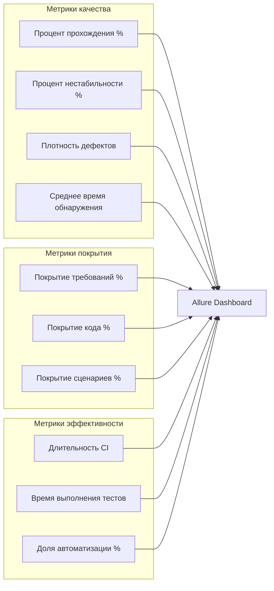

**Разбор каждой метрики:**

| Метрика | Что измеряет | Формула | Почему важна |
|---|---|---|---|
| **Процент прохождения** | Доля прошедших тестов от общего числа | `passed / total × 100%` | Показывает, насколько система стабильна. |
| **Процент нестабильности** | Доля тестов, которые то проходят, то падают | `flaky_runs / total_runs × 100%` | Показывает, насколько CI можно доверять. |
| **Плотность дефектов** | Количество дефектов на единицу кода | `defects / KLOC` | Показывает, насколько код «болезненный». |
| **Среднее время обнаружения** | Сколько времени проходит от дефекта до обнаружения | `mean(time_detected - time_introduced)` | Показывает, насколько быстро мы находим проблемы. |
| **Покрытие требований** | Доля требований, покрытых тестами | `covered_reqs / total_reqs × 100%` | Показывает, насколько полностью мы тестируем. |
| **Покрытие кода** | Доля строк кода, покрытых тестами | `covered_lines / total_lines × 100%` | Показывает, насколько много кода мы проверяем. |
| **Покрытие сценариев** | Доля сценариев, покрытых тестами | `covered_scenarios / total_scenarios × 100%` | Показывает, насколько много поведения мы проверяем. |
| **Длительность CI** | Сколько времени занимает полный CI-пайплайн | `time_ci_start to time_ci_end` | Показывает, насколько быстро мы получаем обратную связь. |
| **Время выполнения тестов** | Сколько времени занимает выполнение всех тестов | `time_test_start to time_test_end` | Показывает, насколько быстро мы можем проверить код. |
| **Доля автоматизации** | Доля тестов, которые автоматизированы | `automated_tests / total_tests × 100%` | Показывает, насколько мы автоматизированы. |

**Почему именно эти 10 метрик?**

1. **Качество** — мы хотим знать, насколько система стабильна и насколько CI можно доверять.
2. **Покрытие** — мы хотим знать, насколько полностью мы тестируем.
3. **Эффективность** — мы хотим знать, насколько быстро мы получаем обратную связь.

**Почему все метрики идут в Allure Dashboard?**

Потому что:
- Allure — это **единый источник** для всех метрик.
- Allure генерирует **HTML-отчёт**, который можно открыть в браузере.
- Allure показывает **тренды** (как метрики меняются со временем).
- Allure показывает **сравнение** (как метрики изменились между версиями).
- Allure позволяет **фильтровать** (по команде, по релизу, по сценарию).

### 13.2 Пороги KPI

| KPI | Цель | Предупреждение | Блокировка |
|---|---|---|---|
| Процент прохождения (smoke) | ≥ 95% | < 90% | < 80% |
| Процент нестабильности | ≤ 2% | > 5% | > 10% |
| Покрытие требований | 100% | — | < 95% |
| Длительность CI (smoke) | ≤ 5 мин | > 10 мин | > 15 мин |
| Доля автоматизации | ≥ 80% | < 60% | < 40% |
| Среднее время обнаружения | ≤ 4 ч | > 8 ч | > 24 ч |

**Разбор каждого порога:**

| KPI | Цель | Предупреждение | Блокировка | Почему |
|---|---|---|---|---|
| **Процент прохождения (smoke)** | ≥ 95% | < 90% | < 80% | Smoke — это критичные тесты. Если они не проходят, система нестабильна. |
| **Процент нестабильности** | ≤ 2% | > 5% | > 10% | Нестабильные тесты ломают доверие к CI. Если их больше 10%, CI бесполезен. |
| **Покрытие требований** | 100% | — | < 95% | Если требования не покрыты, мы не знаем, что они работают. |
| **Длительность CI (smoke)** | ≤ 5 мин | > 10 мин | > 15 мин | Если CI медленный, разработчики не будут его запускать. |
| **Доля автоматизации** | ≥ 80% | < 60% | < 40% | Если автоматизация низкая, мы тратим много времени на ручные тесты. |
| **Среднее время обнаружения** | ≤ 4 ч | > 8 ч | > 24 ч | Если мы долго обнаруживаем дефекты, мы тратим много времени на их исправление. |

**Почему три уровня: цель, предупреждение, блокировка?**

1. **Цель** — это **идеал**. Мы стремимся к нему, но не всегда его достигаем.
2. **Предупреждение** — это **красный флаг**. Если мы ниже порога, нужно обратить внимание и исправить.
3. **Блокировка** — это **критический порог**. Если мы ниже порога, релиз невозможен.

**Почему это важно?**

- **Приоритизация:** Можно сосредоточиться на самых критичных метриках.
- **Прозрачность:** Все видят, какие метрики ниже порога.
- **Отчётность:** Можно сгенерировать отчёт по KPI для руководства.
- **Автоматизация:** Скрипты могут проверять, что все KPI в пределах порога.

**Как CI проверяет KPI?**

```bash
# В .github/workflows/test.yml
- run: npx ts-node qa/scripts/check-kpi.ts
```

Скрипт:
1. Читает Allure-отчёт.
2. Вычисляет все KPI.
3. Сравнивает с порогами.
4. Если есть нарушение — возвращает ошибку.

**Пример ошибки:**

```
Error: KPI violations found:
  - Flaky Rate: 12% (threshold: > 10% = BLOCK)
  - CI Duration (smoke): 18 min (threshold: > 15 min = BLOCK)
```

**Почему это важно?**

- **Качество:** Все KPI в пределах порога.
- **Прозрачность:** Все видят, какие KPI ниже порога.
- **Автоматизация:** Нарушения обнаруживаются автоматически.
- **Защита от ошибок:** Если KPI ниже порога, CI не даст вам merge.

---

## 14. Матрица RACI

> **Цель раздела:** Описать, кто за что отвечает в процессе тестирования. RACI — это матрица ролей, которая устраняет путаницу: кто **ответственный**, кто **принимает решение**, кого **консультуют** и кого **информируют**.

### 14.1 Смысл RACI

| Буква | Английский | Русский | Смысл |
|---|---|---|---|
| **R** | Responsible | Ответственный | Тот, кто **делает** работу. Может быть несколько. |
| **A** | Accountable | Отвечает | Тот, кто **принимает решение** и несёт ответственность. Всегда **один**. |
| **C** | Consulted | Консультируется | Тот, чьё **мнение** нужно до начала работы. |
| **I** | Informed | Информирован | Тот, кого **информируют** после завершения работы. |

**Почему RACI нужен?**

Без RACI в команде возникают ситуации:
- «Я думал, что ты это сделаешь»
- «Я думал, что ты это решил»
- «Никто не знает, кто отвечает»
- «Все отвечают, но никто не принимает решение»

RACI устраняет эту путаницу: для каждой активности есть **один** ответственный (A), **один** исполнитель (R), и чётко определены, кого консультировать (C) и информировать (I).

### 14.2 Матрица RACI для тестирования

| Активность | QA Lead | QA Engineer | Dev Lead | Dev | DevOps | Product |
|---|---|---|---|---|---|---|
| Тест-стратегия | **A** | C | C | I | I | C |
| Тест-объём | **A** | R | C | I | I | C |
| Тест-дизайн | **A** | R | C | I | I | C |
| Feature-файлы | A | **R** | C | I | I | I |
| Step Definitions | I | C | **A** | R | I | I |
| CI Pipeline | C | I | C | I | **A** | I |
| Тестовые данные | **A** | R | C | I | I | I |
| Release Gate | **A** | R | C | I | I | C |
| Defect Triage | **A** | R | C | R | I | I |

**Разбор каждой строки:**

| Активность | Кто и почему |
|---|---|
| **Тест-стратегия** | QA Lead — **A** (принимает решение о стратегии). QA Engineer — **C** (консультация: он будет это исполнять). Dev Lead — **C** (консультация: он знает ограничения). Product — **C** (консультация: он знает бизнес-требования). Dev, DevOps — **I** (информируются). |
| **Тест-объём** | QA Lead — **A** (принимает решение, что тестировать). QA Engineer — **R** (делает: определяет объём). Dev Lead — **C** (консультация: он знает, что изменилось). Product — **C** (консультация: он знает, что важно). Dev, DevOps — **I** (информируются). |
| **Тест-дизайн** | QA Lead — **A** (принимает решение о дизайне). QA Engineer — **R** (делает: проектирует сценарии). Dev Lead — **C** (консультация: он знает реализацию). Product — **I** (информируется). Dev, DevOps — **I** (информируются). |
| **Feature-файлы** | QA Engineer — **R** (делает: пишет feature-файлы). QA Lead — **A** (принимает решение: ревьюит). Dev Lead — **C** (консультация: он знает, что изменилось). Dev, DevOps, Product — **I** (информируются). |
| **Step Definitions** | Dev — **R** (делает: пишет step definitions). Dev Lead — **A** (принимает решение: ревьюит). QA Engineer — **C** (консультация: он знает, что нужно проверить). QA Lead, DevOps, Product — **I** (информируются). |
| **CI Pipeline** | DevOps — **A** (принимает решение: настраивает CI). QA Lead — **C** (консультация: он знает, что нужно запускать). Dev Lead — **C** (консультация: он знает, что нужно проверить). QA Engineer, Dev, Product — **I** (информируются). |
| **Тестовые данные** | QA Lead — **A** (принимает решение: какие данные нужны). QA Engineer — **R** (делает: создаёт файлы данных). Dev Lead — **C** (консультация: он знает, какие данные нужны). Dev, DevOps, Product — **I** (информируются). |
| **Release Gate** | QA Lead — **A** (принимает решение: выпускать или нет). QA Engineer — **R** (делает: проверяет критерии выхода). Dev Lead — **C** (консультация: он знает, что изменилось). Product — **C** (консультация: он знает, что важно). Dev, DevOps — **I** (информируются). |
| **Defect Triage** | QA Lead — **A** (принимает решение: приоритет дефекта). QA Engineer — **R** (делает: репортит дефект). Dev — **R** (делает: чинит дефект). Dev Lead — **C** (консультация: он знает, как чинить). Product — **I** (информируется). DevOps — **I** (информируется). |

**Почему Dev — R для Defect Triage?**

Потому что:
- QA Engineer репортит дефект (R).
- Dev чинит дефект (R).
- QA Lead принимает решение о приоритете (A).
- Dev Lead консультируется (C).

**Почему DevOps — A для CI Pipeline?**

Потому что:
- DevOps настраивает CI (A).
- QA Lead консультируется (C).
- Dev Lead консультируется (C).
- Остальные информируются (I).

**Почему это важно?**

- **Нет путаницы:** Каждый знает, кто за что отвечает.
- **Нет дублирования:** Каждый делает свою работу.
- **Нет провалов:** Каждый знает, кого консультировать и информировать.
- **Быстрое решение:** Ответственный (A) принимает решение, не спрашивая всех.

---

## 15. Управление изменениями (Change Management)

> **Цель раздела:** Описать процесс внесения изменений в тест-план. Этот раздел отвечает на вопрос: «Как правильно внести изменение в тест-план, чтобы оно было review'ировано, задокументировано и не сломало CI?»

### 15.1 Типы изменений

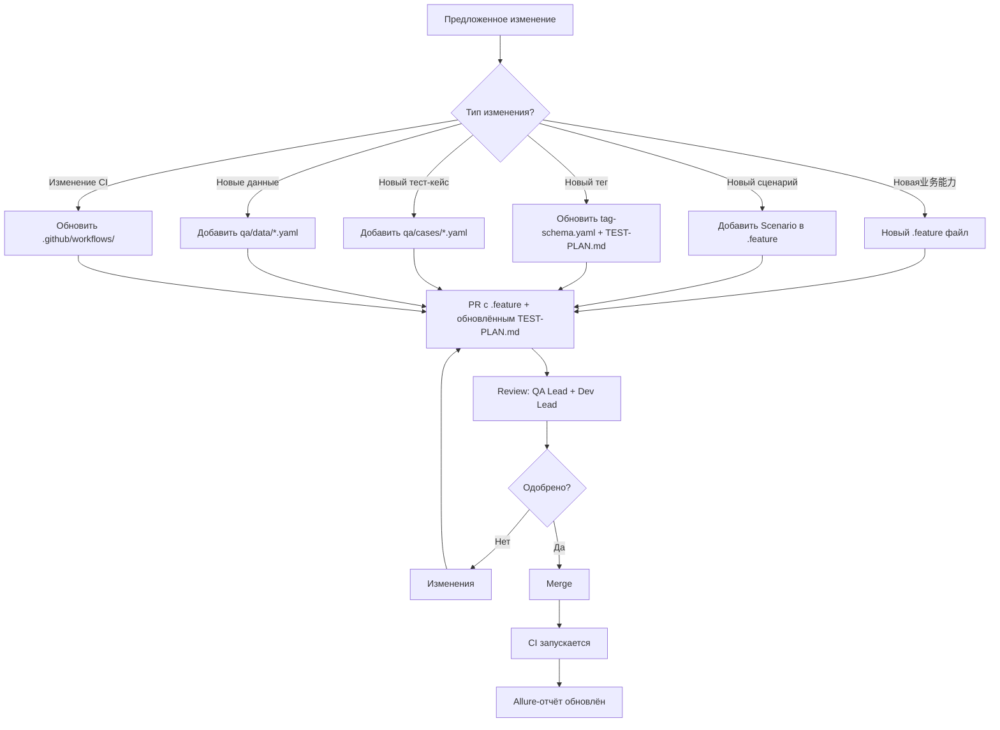

**Разбор каждого типа изменения:**

| Тип изменения | Что нужно сделать | Почему |
|---|---|---|
| **Новая业务能力** | Создать новый `.feature` файл + обновить `TEST-PLAN.md` | Новая业务能力 — это новый раздел тест-плана. Нужно задокументировать. |
| **Новый сценарий** | Добавить `Scenario` в существующий `.feature` файл | Сценарий — это часть业务能力. Не нужно создавать новый файл. |
| **Новый тег** | Обновить `qa/tag-schema.yaml` + `TEST-PLAN.md` | Тег должен быть описан в едином источнике истины. |
| **Новый тест-кейс** | Добавить `qa/cases/*.yaml` | Тест-кейс — это отдельный артефакт. |
| **Новые данные** | Добавить `qa/data/*.yaml` | Данные должны быть в отдельном файле. |
| **Изменение CI** | Обновить `.github/workflows/` | CI — это инфраструктура. Изменения требуют особого review. |

**Почему каждый тип изменения требует PR?**

1. **Review:** Изменение должно быть проверено QA Lead и Dev Lead.
2. **Документация:** Изменение должно быть задокументировано в `TEST-PLAN.md`.
3. **CI:** Изменение должно пройти CI (lint + unit + smoke).
4. **Traceability:** Изменение должно обновить `qa/traceability.csv`.

### 15.2 Правила PR для изменений тест-плана

Любое изменение в тест-плане должно быть **PR**. PR должен включать:

| # | Что должно быть в PR | Почему |
|---|---|---|
| 1 | Изменённый `.feature` / `.yaml` файл | Это **основное** изменение. |
| 2 | Обновлённый `TEST-PLAN.md` (если изменились теги или структура) | Это **документация**. Без неё тест-план будет неактуален. |
| 3 | Обновлённый `qa/traceability.csv` (автогенерация) | Это **связь** между требованиями и тестами. |
| 4 | CI passing (lint + unit + smoke) | Это **проверка**, что изменение не сломало ничего. |

**Почему `TEST-PLAN.md` должен обновляться?**

Потому что:
- `TEST-PLAN.md` — это **документация** для команды.
- Если вы добавили новый тег, но не обновили `TEST-PLAN.md`, новый член команды не будет знать о нём.
- Если вы изменили структуру, но не обновили `TEST-PLAN.md`, тест-план будет неактуален.

**Почему `qa/traceability.csv` должен обновляться?**

Потому что:
- `qa/traceability.csv` — это **связь** между требованиями и тестами.
- Если вы добавили новый сценарий, но не обновили `qa/traceability.csv`, покрытие будет некорректным.
- Если вы удалили сценарий, но не обновили `qa/traceability.csv`, покрытие будет некорректным.

**Почему CI должен пройти?**

Потому что:
- Если lint не прошёл, синтаксис неправильный.
- Если unit не прошёл, код содержит ошибки.
- Если smoke не прошёл, критичные функции не работают.

**Как CI проверяет PR?**

```bash
# В .github/workflows/test.yml
- run: npx gherkin-lint features/**/*.feature  # Lint
- run: npx ajv validate qa/schemas/test-case.schema.json qa/cases/*.yaml  # Validation
- run: npm test  # Unit
- run: npx cucumber --tags "@smoke and not @wip" --format allure  # Smoke
- run: npx ts-node qa/scripts/generate-traceability.ts  # Traceability
- run: npx ts-node qa/scripts/check-coverage.ts  # Coverage
```

Если любое из условий не выполнено — CI возвращает ошибку и не даёт merge.

**Почему это важно?**

- **Качество:** Изменение проверено CI.
- **Документация:** Изменение задокументировано.
- **Traceability:** Изменение обновляет связь между требованиями и тестами.
- **Review:** Изменение проверено QA Lead и Dev Lead.
- **Автоматизация:** Изменение не сломает CI.

---

## 16. Чек-лист гигиены (PR Review)

> **Цель раздела:** Предоставить чек-лист, который QA Lead и Dev Lead используют при review PR с изменениями тест-плана. Этот раздел отвечает на вопрос: «Что проверить перед тем как одобрить PR?»

### 16.1 Чек-лист

```markdown
- [ ] Один файл ≈ одна业务能力 (не одна user story)
- [ ] ≤ 15 сценариев на файл; больше → разбить на sub-features
- [ ] ≤ 5 шагов в блоке Given/When/Then
- [ ] Один шаг = одно атомарное действие
- [ ] Нет составных утверждений в Then
- [ ] Scenario Outline используется для data-driven вариантов
- [ ] Общее поведение в shared/ (не дублируется)
- [ ] Теги Feature: run-set + priority + release (без state-тегов)
- [ ] Теги Scenario: state + traceability (без run-set тегов)
- [ ] Все @REQ-XXX теги имеют соответствующие тикеты
- [ ] Все тикеты с тестами имеют @REQ-XXX теги
- [ ] Нет захардкоженных значений в шагах (использовать qa/data/*.yaml)
- [ ] Gherkin lint проходит
- [ ] Тест-кейс YAML валидируется против схемы
- [ ] Матрица трассируемости сгенерирована и актуальна
- [ ] Реестр рисков обновлён (если новый риск идентифицирован)
- [ ] Критерии входа/выхода всё ещё выполнены
```

**Разбор каждого пункта:**

| # | Пункт | Почему важен |
|---|---|---|
| 1 | **Один файл ≈ одна业务能力** | Если файл описывает несколько业务能力, он становится слишком большим. Лучше разбить на несколько файлов. |
| 2 | **≤ 15 сценариев на файл** | Если больше 15 сценариев, файл становится «стеной текста». Лучше разбить на sub-features. |
| 3 | **≤ 5 шагов в Given/When/Then** | Если больше 5 шагов, сценарий слишком сложный. Лучше разбить на несколько сценариев. |
| 4 | **Один шаг = одно атомарное действие** | Если шаг проверяет несколько вещей, он должен быть разбит. Это позволяет точно определить, что упало. |
| 5 | **Нет составных утверждений в Then** | Если Then проверяет несколько вещей, он должен быть разбит. Это позволяет точно определить, что упало. |
| 6 | **Scenario Outline для data-driven** | Если сценарии отличаются только данными, используйте Scenario Outline. Это предотвращает дублирование. |
| 7 | **Общее поведение в shared/** | Если поведение повторяется в нескольких файлах, вынесите его в `shared/`. Это предотвращает дублирование. |
| 8 | **Теги Feature: run-set + priority + release** | На Feature ставятся только теги, которые описывают весь файл. State-теги на Feature — это ошибка. |
| 9 | **Теги Scenario: state + traceability** | На Scenario ставятся только теги, которые описывают конкретный сценарий. Run-set теги на Scenario — это ошибка. |
| 10 | **Все @REQ-XXX имеют тикеты** | Если тег `@REQ-XXX` не имеет соответствующего тикета, это ошибка. Тикет — это связь с бизнесом. |
| 11 | **Все тикеты с тестами имеют @REQ-XXX** | Если тикет имеет тесты, но нет тега `@REQ-XXX`, это ошибка. Тег — это связь с тестами. |
| 12 | **Нет захардкоженных значений** | Если в шагах есть захардкоженные значения, их нужно вынести в `qa/data/*.yaml`. Это позволяет менять данные без изменения логики. |
| 13 | **Gherkin lint проходит** | Если lint не проходит, синтаксис неправильный. Тест не будет исполняться. |
| 14 | **Тест-кейс YAML валидируется** | Если YAML не валидируется, тест-кейс содержит ошибки. Тест не будет исполняться. |
| 15 | **Матрица трассируемости актуальна** | Если матрица не актуальна, покрытие будет некорректным. Нужно сгенерировать заново. |
| 16 | **Реестр рисков обновлён** | Если новый риск идентифицирован, его нужно добавить в реестр. Это позволяет отслеживать риски. |
| 17 | **Критерии входа/выхода выполнены** | Если критерии не выполнены, тестирование не должно начинаться или релиз не должен выпускаться. |

**Почему чек-лист нужен?**

1. **Стандартизация:** Все PR review'ятся по одному и тому же чек-листу.
2. **Нет пропусков:** Чек-лист помогает не забыть проверить что-то важное.
3. **Обучение:** Новый QA Lead может использовать чек-лист как руководство.
4. **Автоматизация:** Часть пунктов можно автоматизировать (lint, validation, traceability).

**Как использовать чек-лист?**

1. **При review PR:** QA Lead и Dev Lead проверяют каждый пункт.
2. **При создании нового файла:** QA Engineer проверяет чек-лист перед тем как отправить PR.
3. **При обучении:** Новый QA Lead изучает чек-лист и понимает, что важно.

**Почему это важно?**

- **Качество:** Все PR соответствуют стандартам.
- **Нет пропусков:** Чек-лист помогает не забыть проверить что-то важное.
- **Стандартизация:** Все PR review'ятся по одному и тому же чек-листу.
- **Обучение:** Новый QA Lead может использовать чек-лист как руководство.

---

## 17. Глоссарий

> **Цель раздела:** Определить единый набор терминов, используемых в этом документе и во всех тест-планах. Это раздел отвечает на вопрос: «Что означает каждый термин, который мы используем?»

| Термин | Определение |
|---|---|
| **Capability** | Бизнес-функция или поведение системы (например, «запуск браузера»). Это **высший уровень** группировки тестов. Один capability = один `.feature` файл. |
| **Scenario** | Один тест-кейс в Gherkin. Это **минимальная единица** поведения, которую можно проверить. Один сценарий = один путь через систему. |
| **Scenario Outline** | Параметризованный сценарий с таблицей Examples. Это способ описать **несколько** сценариев, которые отличаются только данными, в **одном** блоке. |
| **Run Set** | Именованная коллекция тестов для выполнения (smoke, regression, e2e, api, integration). Это **расписание**: когда запускать тесты. |
| **Tag Expression** | Булева выражение над тегами (например, `@smoke and not @wip`). Это **фильтр**: какие тесты запускать в конкретном запуске. |
| **Traceability** | Связь между требованиями, тестами и дефектами. Это **цепочка**: требование → сценарий → тест-кейс → шаг. |
| **Flaky** | Тест, который непостоянно проходит/падает. Это **проблема**: тест не детерминирован. Нужно исправить или пометить. |
| **WIP** | Work in progress — тест ещё не готов. Это **состояние**: тест не должен запускаться до готовности. |
| **Entry Criteria** | Условия, которые должны быть выполнены **до начала** тестирования. Если не выполнены — тестирование не начинается. |
| **Exit Criteria** | Условия, которые должны быть выполнены **до выпуска** релиза. Если не выполнены — релиз не выпускается. |
| **Risk Score** | Вероятность × Влияние (шкала 1-5). Это **оценка** риска: чем выше, тем критичнее. |
| **KPI** | Key Performance Indicator — ключевой показатель эффективности для качества тестов. Это **метрика**: как мы измеряем качество. |

**Почему нужен глоссарий?**

1. **Единый язык:** Все члены команды используют одни и те же термины.
2. **Обучение:** Новый член команды может быстро освоиться, изучив глоссарий.
3. **Документация:** Глоссарий — это часть документации. Он помогает понять документ.
4. **Review:** При review PR можно ссылаться на глоссарий, чтобы объяснить, что означает термин.

**Почему именно эти термины?**

Потому что:
- Они используются в **всем** документе.
- Они используются в **всех** тест-планах.
- Они используются в **CI** (теги, выражения, отчёты).
- Они используются в **Allure** (отчётность, traceability, KPI).

**Как обновлять глоссарий?**

1. **При введении нового термина:** Добавьте его в глоссарий.
2. **При изменении термина:** Обновите определение.
3. **Раз в спринт:** Проведите review глоссария. Уберите устаревшие термины, добавьте новые.

**Почему это важно?**

- **Понятность:** Все используют один язык.
- **Обучение:** Новый член команды быстро освоится.
- **Документация:** Глоссарий — это часть документации.
- **Review:** При review PR можно ссылаться на глоссарий.

---

## 18. Источники (Sources)

> **Цель раздела:** Перечислить все источники, на которые опирается этот документ. Это раздел отвечает на вопрос: «Откуда взяты эти подходы и стандарты?»

- [ISO/IEC 29119-1:2013](https://www.iso.org/standard/63253.html) — Инженерия ПО — Тестирование ПО — Часть 1: Словарь и общие термины
- [ISO/IEC 29119-2:2013](https://www.iso.org/standard/63254.html) — Инженерия ПО — Тестирование ПО — Часть 2: Планирование тестов, выполнение тестов, отчётность
- [ISTQB Foundation Level Syllabus](https://www.istqb.org/education/istqb-foundation-level) — Программа подготовки на уровне Foundation (базовый уровень)
- [Cucumber Blog: "How to organise feature files?" (Seb Rose, 2021)](https://cucumber.io/blog/bdd/solving-how-to-organise-feature-files) — Статья о том, как организовывать feature-файлы
- [Gherkin Reference](https://github.com/cucumber/gherkin) — Референс по формату Gherkin
- [Allure Gherkin Integration](https://allurereport.org/docs/gherkin/) — Интеграция Allure с Gherkin
- [Gherkin-lint](https://github.com/cucumber/gherkin-lint) — Инструмент для lint-проверки Gherkin-файлов
- [AJV JSON Schema Validator](https://ajv-validator.com/) — Валидатор JSON Schema на Node.js

**Почему перечислены именно эти источники?**

1. **ISO/IEC 29119-1** — определяет терминологию и процессную модель тестирования. Это **основа** для всех терминов в этом документе.
2. **ISO/IEC 29119-2** — определяет планирование, выполнение и отчётность тестов. Это **основа** для критериев входа/выхода и отчётности.
3. **ISTQB Foundation Level** — определяет техники проектирования тестов и уровни тестирования. Это **основа** для стратегии тестирования.
4. **Cucumber Blog** — определяет, как организовывать feature-файлы. Это **основа** для структуры feature-файлов.
5. **Gherkin Reference** — определяет формат Gherkin. Это **основа** для синтаксиса сценариев.
6. **Allure Gherkin Integration** — определяет, как интегрировать Gherkin с Allure. Это **основа** для отчётности.
7. **Gherkin-lint** — определяет, как проверять синтаксис Gherkin. Это **основа** для CI-проверки.
8. **AJV JSON Schema Validator** — определяет, как валидировать JSON Schema. Это **основа** для валидации тест-кейсов.

**Почему это важно?**

- **Прозрачность:** Все подходы имеют источник.
- **Обоснование:** Каждый подход можно обосновать ссылкой на источник.
- **Обучение:** Новый член команды может изучить источники и углубиться в тему.
- **Обновление:** Если источник обновляется, можно обновить документ.
